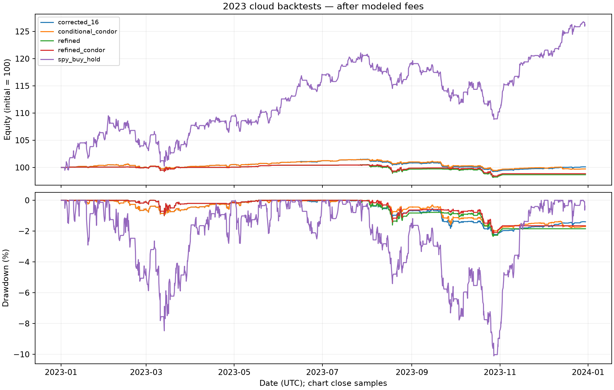

# TabPFN Options Lab

**Ask what a model could have known—not just what it can predict.**

A runnable, local **TabPFN-3.5** experiment for chronological options-research classification. Compare an empirical-frequency baseline, a chronologically tuned XGBoost classifier, and real TabPFN-3.5 inference on the **same candidates**, with only outcomes resolved before each decision admitted to the fitting context.

**[Read the research paper (PDF)](research/RESEARCH_PAPER.pdf)** · **[Paper in Markdown](research/RESEARCH_PAPER.md)** · **[Provenance and historical limitations](research/PROVENANCE.md)** · **[Submission description](SUBMISSION.md)**

**[Narrated demo — 2:13 MP4](https://github.com/ArielleTolome/tabpfn-options-lab/releases/download/v0.1.0/tabpfn-options-lab.mp4)** · **[Video contact sheet](video/contact-sheet.jpg)** · **[Recorded synthetic report (HTML)](examples/index.html)** · **[Report JSON](examples/report.json)**

> **Research, not a trading product.** The included dataset is unmistakably **synthetic**: generated features and Bernoulli labels, not option quotes, trades, returns, or reconstructed QuantConnect data. Synthetic Brier scores demonstrate the harness, not a market edge. The original paper specifies **TabPFN-3 (V3)**; this new project explicitly uses **TabPFN-3.5**. The original historical ML comparison remains incomplete. No calibrated market probabilities, superior trading performance, live-trading safety, or institutional endorsement are claimed.

## Why this exists

Small options datasets are tempting territory for tabular models—and easy territory for misleading results. A spread opened before today's decision may still be unresolved. A random split can leak overlapping outcomes. A model can look accurate while transaction costs erase its economic value. A high probability of a gross-credit target is not the same event as after-fee profitability.

TabPFN Options Lab turns those distinctions into an inspectable experiment:

- **Real model, explicit version.** `tabpfn==9.2.0` and `ModelVersion.V3_5`; no silently substituted V3 checkpoint, invented probability, or fallback classifier.
- **Strict temporal cutoff.** A label becomes available only when its timestamp is strictly earlier than the candidate's entry timestamp.
- **Purged model selection.** XGBoost's tuning segment is chronological; training outcomes overlapping its first decision are removed.
- **Same scoring population.** Every model forecasts every evaluation candidate; selection tiers never hide rejected examples from Brier scoring.
- **Auditable outputs.** A JSON report and a standalone HTML report expose probabilities, illustrative quantities, fitting-window size, last-known-label timestamps, and model provenance.
- **Honest evidence boundaries.** A deterministic public synthetic fixture makes the software runnable without publishing restricted historical data. Authorized-data mode uses the same contract, not a covert data downloader.

Here **causal** means *information-time causal*: predictions cannot consume later labels. It does not mean randomized causal identification, proof that a feature causes returns, or elimination of all market leakage.

## Quickstart

### 1. Install the pinned environment

Use **Python 3.12 or newer**. The pinned NumPy and XGBoost releases require it. A Python 3.12 virtual environment is the reference setup:

```bash
git clone https://github.com/ArielleTolome/tabpfn-options-lab.git
cd tabpfn-options-lab
python3.12 -m venv .venv
source .venv/bin/activate
python -m pip install -r requirements.txt
```

Direct dependencies are pinned to `tabpfn==9.2.0`, `xgboost==3.4.1`, and `numpy==2.5.4`; see [requirements.txt](requirements.txt). Transitive dependencies and CUDA compatibility still depend on your platform. The harness does not install drivers or purchase compute.

### 2. Obtain the model yourself, under its separate terms

The source-code license **does not license TabPFN weights or outputs**. Before downloading or using weights, read the official [TabPFN-3.5 model card](https://huggingface.co/Prior-Labs/tabpfn_3_5) and [model license](https://huggingface.co/Prior-Labs/tabpfn_3_5/blob/main/LICENSE). If you qualify and agree, request access through the model's Hugging Face page yourself. This project cannot accept those terms or grant access for you.

The published license permits specified non-commercial, non-production research/evaluation, restricts outputs as well as weights, excludes certain consumer use, and requires separate permission for commercial/production or hosted-service use. Read the full license; this summary is not legal advice. Do not use this demo's outputs for trading or commercial decision-making without appropriate rights and independent validation.

After access has been granted, download the **full V3.5** checkpoint—not V3, V3.5-Fast, or the experimental multiclass variant:

```bash
# Run interactively; never put your access token in a command, notebook, or commit.
.venv/bin/hf auth login
.venv/bin/hf download Prior-Labs/tabpfn_3_5 \
  tabpfn-v3.5-20260909.safetensors \
  --revision 06bf2ba35c80a92a3b9abb436b99cf49e7a0365e \
  --local-dir weights
export TABPFN_MODEL_PATH="weights/tabpfn-v3.5-20260909.safetensors"
```

The explicit `.venv/bin/hf` selects Hugging Face's CLI from this environment rather than a same-named system command. `weights/` must remain local. Alternatively, an already authorized checkpoint in TabPFN's expected package cache can be used without `TABPFN_MODEL_PATH`. The harness requires an existing checkpoint before fitting; it does not download weights, open a license-acceptance browser, or silently fall back. It checks the loaded configuration for TabPFN-v3.5 identity.

### 3. Run all three models on the synthetic example

On a compatible NVIDIA CUDA setup:

```bash
python demo.py --device cuda --output demo-output
```

CPU-only alternative, explicitly reading the included fixture:

```bash
python demo.py --input examples/synthetic.json --device cpu --output demo-output-cpu
```

`--device auto` lets the model choose an available device. Device selection affects TabPFN; XGBoost intentionally uses one CPU worker. A working CUDA-enabled PyTorch installation and compatible NVIDIA driver are required for `cuda`. CPU is supported but can be substantially slower. There is no measured minimum RAM/VRAM or wall-clock guarantee for this release; model initialization, fitting context, ensembles, and platform determine resource use. The example has six features, 560 seed rows, and 12 weekly candidates, not the model's maximum advertised scale.

Open the generated `demo-output/index.html` in a browser; `demo-output/report.json` is the machine-readable companion. The HTML report is static—no inference service, account, or hosted API is needed. The command refuses to overwrite an existing report: choose a new output directory for a new run. A model, checkpoint, validation, or dependency failure is an error, not a replacement score.

The checked-in [sample HTML report](examples/index.html) and [JSON](examples/report.json) record a completed genuine CUDA run using `tabpfn==9.2.0`, 560 synthetic seed rows, and 12 synthetic candidates. Clone the repository or download **both files into the same directory**, then open `index.html`; adjacent `report.json` is needed for its machine-readable-report link. GitHub's file view may show HTML source rather than render the page.

| Model | Recorded Brier on 12 synthetic candidates |
|---|---:|
| Empirical frequency | 0.139359 |
| Tuned XGBoost | 0.144116 |
| TabPFN-3.5 | 0.129392 |

**These are software-demonstration scores, not an options benchmark or evidence of financial superiority.** The tiny generated cohort cannot establish calibration, a stable model ranking, or trading profitability. The sample exists to make actual inference and report interpretation inspectable.

The default generated-input CPU path also completed on the same normalized input hash and all 12 candidates; its TabPFN Brier was **0.130255**, versus **0.129392** in the recorded CUDA example. Exact numerical equality across devices, library versions, and kernels is **not promised**. These device-specific synthetic observations do not change the evidence boundary above.

### Lightweight regression checks

```bash
python -m unittest test_demo.py
```

These standard-library checks exercise the data/causality/report contract without loading model weights. Passing them is not a substitute for running actual model inference or for historical strategy validation.

## The six features and their units

`x` is an ordered array of exactly six finite numbers. Its order is fixed by [tabpfn_filter.py](tabpfn_filter.py); changing the order changes the model's input meaning.

| Position | Feature | Meaning and units |
|---:|---|---|
| 0 | `iv_rank_30d` | `100 × (IV30 − min(H)) / (max(H) − min(H))`, in **0–100 rank points**, using the latest 30 valid once-daily IV30 observations available at the scan, including that scan. It is min–max rank, not percentile. A flat window is undefined and must not be fabricated. |
| 1 | `vrp_spread` | `IV30 − RV30`, in **decimal annualized volatility units**. `0.03` means three volatility percentage points, not a 3% relative increase or three variance points. RV30 uses 30 completed daily log returns with sample standard deviation annualized by `sqrt(252)`. This is a backward-looking volatility-gap proxy, not an observed future variance premium. |
| 2 | `vix_slope` | Latest eligible completed `VIX / VIX3M`, a **dimensionless positive ratio**. The original protocol accepts observations one to four calendar days old; it does not use unavailable same-day closing index values. It is not a VIX futures curve. |
| 3 | `underlying_rsi` | SPY **Wilder RSI(14), 0–100 points**, computed from completed daily bars available at the decision. |
| 4 | `net_credit_yield` | Candidate executable-side credit per share divided by spread width, a **dimensionless fraction** between zero and one. Despite the name, this is **before commissions**; it is not expected net return. `$0.50 / $5 = 0.10`. |
| 5 | `short_delta` | Current model delta of the actual selected short put, a **dimensionless negative value**, approximately `−0.16` in the reference protocol. It is not assignment probability or target-success probability. |

For historical data, IV30 in the paper is a sparse ATM term-structure estimate: average valid current put/call model IV at the spot-nearest strike, interpolate total variance between expiries bracketing 30 calendar days, then convert back to volatility. It is not a fitted, arbitrage-free full surface. RV30 requires 31 completed closes. The original study uses raw prices for strike comparisons and explicitly adjusted prices for RV; feature builders must document their own corporate-action treatment.

The public CLI consumes feature snapshots; it does **not** reconstruct these features from market data or certify that user-supplied snapshots were genuinely available at the stated time. Synthetic features are numerical demonstrations of this schema, not estimates from option prices.

## What the label means

The original research label is:

- **`y = 1`:** a completed profit-target exit with **more than 21 calendar DTE remaining**, whose actual filled **gross** spread profit reaches at least 50% of filled opening credit.
- **`y = 0`:** a DTE/stop exit, or a target-triggered fill that misses that realized gross threshold. The original protocol does not add a new stop-loss rule merely because the label helper recognizes stop outcomes.
- **Exclude/censor:** forced final-session exits; do not relabel them as losses for convenience. Assignment or execution failure invalidates the original data-producing run.

Freeze entry features before order submission. `label_time` is when all closing legs have filled and the outcome is known, not the entry time or the first target quote. This target event is different from after-fee profitability, expiration ITM status, and individual-leg win rate.

The included fixture uses generated Bernoulli indicators as toy labels. It has no option price paths or filled legs and therefore does not establish genuine attainment of this economic target. Authorized input supplies `y` explicitly; the CLI checks its shape and timing, not the underlying execution evidence. You remain responsible for correct labels and censoring.

## Temporal separation and purged tuning

For a candidate entering at time `t`:

1. Keep rows with `entry_time < label_time < t`. A label timestamp **equal to `t` is excluded**.
2. Only after filtering for availability, sort by entry time and retain the latest **5,000** rows. Unresolved recent rows cannot displace older eligible examples.
3. Require at least **500** available labels and both classes for every candidate. The comparison fails rather than silently dropping candidates for one model.
4. Fit each model on the same available history. For XGBoost tuning, use the latest 20% by entry time as a chronological validation segment and purge earlier training rows whose labels were not known before that segment's first entry. Select depth/learning-rate by validation Brier, then refit on the full currently eligible context. An unusable purged split is an error.
5. Predict before revealing the candidate's outcome. Candidate outcomes can enter later fitting contexts only once their own `label_time` is strictly earlier than the later decision.

The empirical baseline predicts the available history's target-success frequency. It is not `1 − abs(delta)`. XGBoost searches `max_depth ∈ {2, 3}` and `learning_rate ∈ {0.03, 0.10}` with 100 trees and a fixed random seed. TabPFN performs in-context classification with the explicit V3.5 checkpoint; it does not run a task-specific gradient fine-tuning or hyperparameter search.

All models score the same candidate labels, including candidates their illustrative trading gate would reject. This is a policy-independent observation-stream assumption. It avoids selection-conditioned scoring but does not establish that rejected spreads were actually traded. It is also not a blanket purge of every dependence between overlapping options outcomes: residual correlation, common market shocks, revised data, feature leakage, and pretraining/version timing remain research concerns.

## Authorized-data mode and JSON schema

The included [examples/synthetic.json](examples/synthetic.json) is the complete runnable data example. To use your own dataset, create the same JSON structure, explicitly set `data_kind` to `"authorized"`, and keep it outside the public repository:

```bash
python demo.py --input ../authorized-input.json --device auto --output private-output
```

`authorized` records your declared provenance; it is **not** an audit, legal permission, or license check. Only supply data you are permitted to process using this model. Do not export restricted QuantConnect rows through another route, upload credentials, commit personal data, or turn a failed export into a synthetic-looking historical dataset.

### Top level

Only these four top-level keys are accepted:

| Key | Required value |
|---|---|
| `schema_version` | Integer `1` |
| `data_kind` | Exactly `"synthetic"` or `"authorized"` |
| `history` | Array of seed outcome rows, available only according to their individual timestamps |
| `candidates` | Nonempty array of retrospective evaluation rows in strictly increasing `entry_time` order |

### Rows

| Field | History row | Candidate row |
|---|---|---|
| `x` | Ordered array of six finite feature values | Same |
| `y` | Integer `0` or `1` | Same; used for scoring only after prediction, and for later context only after resolution |
| `entry_time` | ISO-8601 timestamp with explicit UTC offset | Same |
| `label_time` | ISO-8601 timestamp with explicit UTC offset, strictly after entry | Same |
| `id` | Not part of the history-row contract | Unique nonempty string |

Use timestamps such as `2025-01-06T15:15:00+00:00` or `2025-01-06T15:15:00Z`; naive timestamps are rejected. Offset-aware timestamps are compared in a common time frame. Candidate IDs must be unique. Duplicate `(entry_time, x)` records across the seed and candidate streams are rejected. All rows must obey the feature and label validation in the implementation. This is a retrospective evaluation interface, not a live unlabeled signal service.

## Reading the outputs

| Output | Meaning | Not evidence of |
|---|---|---|
| Input-kind label and provenance | Whether you ran the deterministic synthetic example or declared authorized input | Third-party data permission or audit |
| Per-model Brier score | Mean `(p − y)²` on the identical candidate cohort; lower is better for this supplied target | Calibration alone, statistical significance, profit, or market superiority |
| Candidate probability `p` | That model's estimate for the supplied binary target | A known physical market probability, option delta, or a guarantee |
| Illustrative requested quantity | The same fixed probability-tier mapping shown for each forecast, including the empirical baseline | Submitted orders, margin-aware execution, Kelly sizing, or capital allocation advice |
| Context size and latest label timestamp | What historical outcome context was permitted at that decision | Proof that the supplied source features or labels were honestly timestamped |
| Tuning and model provenance | Selected parameters, model identity, environment and input binding recorded by the harness | A completed historical backtest or a performance guarantee across environments |

The illustrative quantity rule is **0 below 0.82**, **1 from 0.82 up to but not including 0.90**, and **2 from 0.90 through 1**. These are inherited fixed research thresholds, not tuned by the synthetic example. They are **not fractional Kelly**: a target-success probability does not supply the complete payoff distribution, conditional loss severity, cost model, or estimation uncertainty needed for that calculation. The public harness applies this display rule to every forecast but does not execute quantities or apply brokerage/margin constraints. Its empirical-rate forecast is not the original paper's fixed-one-contract mechanical execution portfolio.

The report deliberately does not compute Sharpe, drawdown, dollar profit, after-fee win rate, or an equity curve. The input schema contains no cash-flow or quote path from which to establish those metrics. A small or zero Brier difference on 12 synthetic candidates is not a reliable model ranking. The generator is deterministic; numerical forecasts need not be bit-for-bit identical across hardware, libraries, or kernels.

`report.json` has top-level `schema_version`, `project`, `data_kind`, `notice`, `input_sha256`, `features`, `device_requested`, `n_history`, `protocol`, `models`, and `predictions`. `input_sha256` fingerprints canonical normalized JSON, not the original file's whitespace. `models.empirical`, `models.xgboost`, and `models.tabpfn` contain `label`, `n_candidates`, and `brier_score`. Each `predictions` row retains the retrospective input row plus each model's `p`, `illustrative_contracts`, `as_of`, `n_train`, `latest_label_time`, `first_training_entry_time`, model identity/version, hyperparameters, timing, refit, and status metadata. XGBoost adds its purged tuning split and validation Brier; TabPFN adds loaded architecture and resolved-device metadata. This is an audit record, not a label-free live signal feed.

## The paper: negative findings are part of the result

The [paper PDF](research/RESEARCH_PAPER.pdf) and [Markdown](research/RESEARCH_PAPER.md) report the original mechanical-options study and its **uncompleted V3 ML extension**, not a historical V3.5 backtest. The preprint is **not peer-reviewed**.

- Corrected 2023 SPY 16-delta control: **$110 net after $884 modeled fees** across 221 packages. The combined IV-filter/sizing policy returned **−1.334%**, versus **+26.298%** for the separately simulated SPY buy-and-hold comparator. None of the valid option cases exceeded SPY's Sharpe.
- The selected 75%-target/21-DTE variant lost **$363 in 2024** and **$3,667 in 2025** and failed its frozen confirmation screen.
- The trend gate's January–June 2026 comparison followed inspection of a failed January–September attempt. It is **postinspection descriptive evidence**, not an untouched holdout.
- The credit-floor extension's small positive results failed robustness: three periods had too few packages, and a further $4-per-package cost sensitivity changed the sum of separate-period profits from **+$243 to −$17**.
- QQQ's adjustment-boundary exits remain invalid. No stale-price liquidation, invented transfer, capped closing debit, or zero-filled result repairs them.
- The original V3/XGBoost/mechanical common-cohort ML table is still **not measured**, because complete authorized data export remains a prerequisite. Synthetic model calls do not fill it.



The figure is an archived mechanical-strategy exhibit, not a public-demo output. Low exposure, sampled rather than intraday drawdown, and idle cash matter. Later annual portfolios reset independently to $100,000; sums of annual P&L are not continuous compounded returns. See [research provenance](research/PROVENANCE.md) for the source hashes, run identifiers, figure interpretation, and publication boundary.

## Costs, limitations, and responsible use

- **No market-data bundle.** There are no restricted QuantConnect datasets, raw result dumps, private logs, credentials, or checkpoints in the release. Public synthetic reproducibility is distinct from access to original historical evidence.
- **No automatic trading or paid service.** The harness uses local inference, no brokerage connection, no paid inference endpoint, and no compute purchase. Package/checkpoint downloads need internet access and storage. Optional infrastructure or historical data may carry separate costs and permissions.
- **No execution simulator.** The paper uses executable-side bid/ask decision quotes and actual simulated fill/fee accounting. This harness does not reproduce fills, spreads, commissions, slippage, assignment, liquidity, margin, or capacity. Never cap a pre-expiry liquidation debit at its terminal payoff width to improve results.
- **No generalization promise.** Synthetic task structure, small samples, overlapping exposures, nonstationarity, correlated labels, model-version timing, and selective research choices limit inference. Chronological labels alone do not make an inspected period an untouched test.
- **No intrinsic probability guarantee.** Neither a short-put delta near −0.16 nor a foundation-model posterior establishes an 84% physical win rate, calibration, or an economic edge. Brier is a proper probability score, not a profit measure or a calibration-only statistic.
- **Rights remain separate.** Model and output restrictions can be narrower than the code license. Historical data, figures, paper, and audiovisual media do not become openly relicensed merely because they sit beside Apache-licensed code.

This is educational research software, not investment advice. Genuine follow-on evidence would require lawfully obtained data, independently auditable timing and accounting, frozen rules, appropriate cost assumptions, and genuinely held-out or prospective observations—not repeated optimization on the same inspected years.

## Project map

```text
README.md                         Setup, schema, methodology, limitations
SUBMISSION.md                     Ready-to-paste project description; eligibility caveat
LICENSE                           Apache License 2.0 for the public source-code release
demo.py                           CLI, synthetic inputs, comparison, JSON/HTML report
tabpfn_filter.py                   Six-feature, causal-history, model and tier helpers
requirements.txt                  Pinned direct inference dependencies
test_demo.py                      Lightweight contract/regression checks
examples/synthetic.json           Complete generated fixture; not market data
examples/index.html               Recorded genuine inference on synthetic inputs
examples/report.json              Full-precision report; keep beside example HTML
research/RESEARCH_PAPER.md         Privacy-edited original V3 preprint
research/RESEARCH_PAPER.pdf        PDF rendered from the public Markdown
research/PROVENANCE.md             Source fingerprints, run anchors, evidence boundary
research/NOTICE.txt                Paper/figure/media rights and publication boundary
research/ORIGINAL_CODE_LICENSE.txt Original MIT notice for the derived filter
research/*.png                    Three original aggregate research figures
video/                           Narrated composition source, audio, captions, stills
YOUTUBE.md                       Prepared video metadata; not an upload claim
```

The [video reproduction guide](video/README.md) documents the narrated composition and its media. The final MP4 is distributed as the linked GitHub release asset rather than checked into source control.

## License, attribution, and event status

The public source-code release and usage documentation use [Apache-2.0](LICENSE). `tabpfn_filter.py` adapts the author's original MIT-licensed research helper; the [original copyright and MIT notice](research/ORIGINAL_CODE_LICENSE.txt) remain preserved. The original private research is not relicensed by this release. The manuscript, PDF, figures, and separately supplied audiovisual media retain their existing rights; see [research/NOTICE.txt](research/NOTICE.txt). TabPFN code, weights, and outputs retain their own applicable terms. No model weights are redistributed.

The project was prepared with the [TabPFN-3.5 hackathon](https://platform.priorlabs.ai/hackathon-3.5) in mind. Its published terms state a deadline of **6 October 2026 at 23:59 CEST** and no late submissions (§§3.6–3.7). This release is dated **15 October 2026**, so eligibility is **unconfirmed and late under those published terms** unless the organizer explicitly grants an exception or extension. A registration/acceptance message does not by itself establish that late project submissions are eligible. This repository makes no submission, acceptance, award, or endorsement claim. [SUBMISSION.md](SUBMISSION.md) records the requirements and an honest description that can be used if eligibility is confirmed.

AI tools assisted implementation, research synthesis, documentation, and presentation. Historical numerical claims are attributed to the original study's recorded outputs; no AI-generated market-performance series are substituted for missing evidence.

## Citations and primary sources

1. **Ariel Tolome (2026).** [*Systematic Multi-Leg Options Volatility Arbitrage and Implied Volatility Surface Modeling*](research/RESEARCH_PAPER.md). Public-edition preprint, not peer-reviewed. Its ML specification is V3; the historical comparison is not complete.
2. **Prior Labs.** [TabPFN-3.5 model card](https://huggingface.co/Prior-Labs/tabpfn_3_5), [checkpoint and license at the documented revision](https://huggingface.co/Prior-Labs/tabpfn_3_5/tree/06bf2ba35c80a92a3b9abb436b99cf49e7a0365e), [TabPFN source](https://github.com/PriorLabs/TabPFN), and [package v9.2.0](https://github.com/PriorLabs/TabPFN/releases/tag/v9.2.0). Package version and model generation are distinct identifiers.
3. **Hollmann et al. (2025).** [“Accurate predictions on small data with a tabular foundation model,” *Nature*](https://www.nature.com/articles/s41586-024-08328-6). This paper concerns an earlier TabPFN generation; it does not establish V3.5 performance on options.
4. **Grinsztajn et al. (2026).** [*TabPFN-3: Technical Report*](https://arxiv.org/abs/2605.13986). Original-study model context, not a V3.5 options benchmark.
5. **XGBoost developers.** [Parameter tuning](https://xgboost.readthedocs.io/en/stable/tutorials/param_tuning.html) and [Python API](https://xgboost.readthedocs.io/en/stable/python/python_api.html).
6. **QuantConnect.** [Object Store permissions](https://www.quantconnect.com/docs/v2/writing-algorithms/object-store), [fill modeling](https://www.quantconnect.com/docs/v2/writing-algorithms/reality-modeling/trade-fills/supported-models), and [fee modeling](https://www.quantconnect.com/docs/v2/writing-algorithms/reality-modeling/transaction-fees/supported-models). Platform documentation does not prove strategy profitability or grant data-export permission.
7. **Prior Labs.** [TabPFN-3.5 hackathon page and published terms](https://platform.priorlabs.ai/hackathon-3.5). The event-status caveat above is part of this release, not an inferred extension.

The [paper's reference list](research/RESEARCH_PAPER.md#references) includes the option-pricing, variance-premium, corporate-action, and simulator sources supporting the original study's narrower claims.
