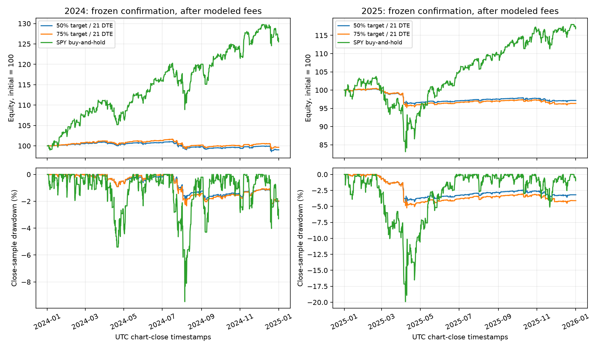
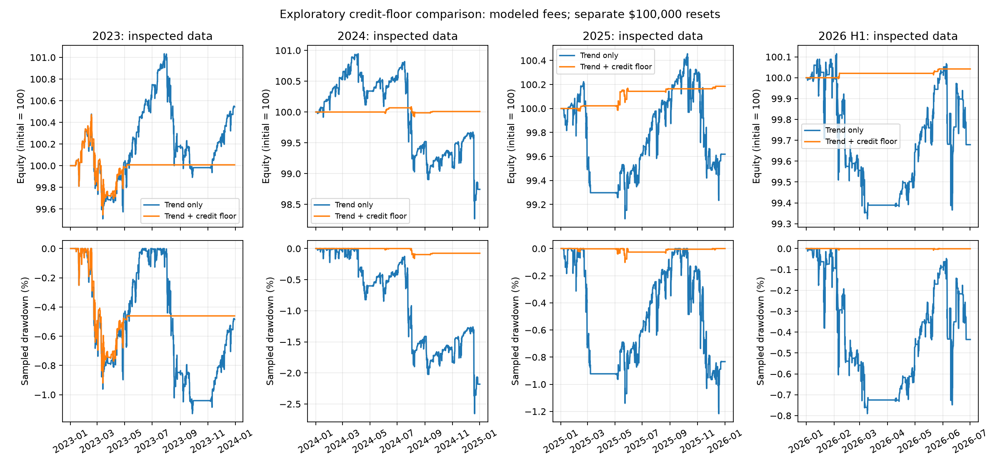

# Systematic Multi-Leg Options Volatility Arbitrage and Implied Volatility Surface Modeling

> **Public-edition note — 2026-10-15.** This is the original options study, whose proposed ML extension explicitly uses **TabPFN-3 (V3)**. It has **not** been renamed to V3.5. The separate runnable **TabPFN Options Lab** project uses **TabPFN-3.5** on synthetic or authorized user-supplied data and makes no historical trading-performance claim. This edition preserves the original methods, aggregate findings, failed-run disclosures, and negative conclusions while removing personal identifiers and private operational references. It adds the archived exit-rule figure beside its existing results. No restricted datasets, raw logs, credentials, or weights accompany the paper. Historical cloud links are provenance references and may require permission; they are not public data downloads. See [provenance](PROVENANCE.md) and [the runnable harness](../README.md).

**Empirical scope:** Defined-risk equity-option credit spreads, delta selection, and sparse ATM implied-volatility term-structure modeling. “Arbitrage” in the project title is not a claim of riskless profit; this implementation does not fit a full arbitrage-free volatility surface.

**Author:** Ariel Tolome  
**Research platform:** QuantConnect LEAN  
**Status:** Public-edition preprint, not peer-reviewed. Ten valid 2023 Phase 1 comparisons and later mechanical annual comparisons are documented; QQQ remains invalid. Trend-study 2023–2025 runs are development evidence, and January–June 2026 is postinspection descriptive evidence, not untouched confirmation. The originally requested January–September 2026 control failed and is retained separately. Comparative ML results remain blocked by authorized data export. No journal acceptance, institutional endorsement, or completed historical ML comparison is asserted.

## Abstract

This retrospective QuantConnect LEAN study evaluates defined-risk equity-option credit spreads with $100,000 initial capital per run. In the initial 2023 comparison, ten of eleven configurations produced valid completed results; the QQQ extension failed required exits around an option-contract adjustment. The corrected SPY 16-delta reference returned 0.110%, with native Sharpe 0.065 and maximum drawdown 2.300%. Combining an implied-minus-historical-volatility filter with VIX-regime sizing returned −1.334%, versus 26.298% for separately traded SPY buy and hold. None of the valid 2023 option configurations exceeded SPY's Sharpe. Later exit-rule comparisons were also unfavorable: the selected 75% profit-target policy lost $363 in 2024 and $3,667 in 2025 and failed its predeclared confirmation screen.

A 50-day trend gate produced a sum of annual net P&L of −$1,094 versus −$3,712 for its control over 2023–2025 development runs. These are separate annual portfolios reset to $100,000, not a continuous three-year account. Their worst annual drawdowns were 2.7% and 4.5%, respectively; these are not continuous three-year drawdowns. The protocol reserved January–September 2026, but that control attempt failed with unresolved positions in July. January–June 2026 reruns were then selected after inspection and remain descriptive only: the gate lost $321 versus the control's $672 loss. Thus the observed multi-period evidence does not establish consistent after-cost profitability or a validated trend-confirmation result. The study distinguishes volatility signals from variance premia, delta from probability, and defined-risk trading from arbitrage; it does not claim a novel trading edge or live-trading efficacy.

A subsequent fixed credit/width floor of 10%, combined with the trend gate, produced small positive net results in all four inspected periods: $8, $8, $185, and $42. It nevertheless failed its registered robustness screen: three periods had fewer than 30 packages, and an additional $4 round-trip cost sensitivity eliminated the 2023 and 2024 profits. The 2026 result contains only two packages. These exploratory results do not establish scalable profitability or justify live deployment.

The Phase 2 extension specifies a causal six-feature TabPFN-3/XGBoost comparison and fixed probability-based contract tiers. Its empirical model comparison is not yet available: the verified Researcher organization cannot export Object Store data without additional authorization, while ordinary logs truncate. No ML Sharpe improvement, calibration advantage, or trading edge is asserted.

**AI-assistance disclosure:** AI tools assisted with software implementation, experiment orchestration, source research, and manuscript drafting. The reported numerical findings reproduce recorded simulator outcomes in the source manuscript, not generated performance examples. This public edition removes personal identifiers and private operational references; it does not independently revalidate the historical experiments.

**Keywords:** equity options; credit spreads; variance risk premium; implied volatility; backtesting; model risk.

## 1. Research Question and Scope

Selling options can earn compensation for bearing adverse market states, but that economic hypothesis is not a guarantee of positive returns. In particular, an out-of-the-money bull put spread retains positive directional exposure and can lose when the underlying falls. A long protective put limits its contractual expiration loss; it does not convert the trade into arbitrage or remove its dependence on the underlying price path, implied-volatility changes, liquidity, fees, and execution quality.

The research question is therefore deliberately narrower than whether options contain a universally exploitable mispricing: **how do delta selection, a backward-looking volatility signal, conditional call-side exposure, and position sizing change the simulated performance of a specified credit-spread strategy over a common sample?** The experiment separates implementation corrections from parameter comparisons. The untouched original source is preserved for diagnosis; a corrected reference implementation anchors the controlled comparisons. Subsequent exit-rule and trend-gate studies extend the descriptive evidence to separate annual runs in 2024–2025 and a postinspection shortened 2026 interval; their distinct protocols and validation limits are reported in Sections 8.6–8.8.

The study does not dynamically delta-hedge its option positions. Neither the put-spread strategy nor the conditional-condor variation is described as delta-neutral. Even when both call and put spreads are present, unequal wing deltas, strike discreteness, skew, dividends, and subsequent market movements generally leave residual delta. A conditional policy that sometimes holds only the put spread is especially distinct from an always-on, continuously rebalanced neutral portfolio.

## 2. Theoretical Framework

### 2.1 Variance Risk Premium, Volatility Spread, and Forecasting

Let $t$ be the observation time, $\tau$ the horizon in years, and $\mathcal{V}_{t,t+\tau}$ annualized realized log-return variation over the **future** interval. In a diffusion with jumps, an idealized continuous-observation definition is

$$
\mathcal{V}_{t,t+\tau}
=\frac{1}{\tau}\left(
\int_t^{t+\tau}\sigma_u^2\,du
+\sum_{t<u\leq t+\tau}(\Delta\log S_u)^2
\right).
$$

Using the seller-positive sign convention, the ex ante variance risk premium is

$$
\operatorname{VRP}_{t,\tau}
=\mathbb{E}^{\mathbb{Q}}_t[\mathcal{V}_{t,t+\tau}]
-\mathbb{E}^{\mathbb{P}}_t[\mathcal{V}_{t,t+\tau}],
$$

where $\mathbb{Q}$ is a pricing measure and $\mathbb{P}$ is the physical probability measure. Some literature reports the opposite sign, corresponding to the expected payoff to a buyer of variance. A sign convention must therefore accompany any quoted premium. Carr and Wu [3] study option-based variance measures and variance risk premiums; Bollerslev, Tauchen, and Zhou [4] distinguish expected variance premia from observable implied-minus-lagged-realized proxies. Their empirical findings motivate the question, not a guaranteed premium for every security or date.

A difference between annualized volatility estimates,

$$
g_t=\widehat{\sigma}_{\mathrm{IV30},t}-\widehat{\sigma}_{\mathrm{hist},t},
$$

has volatility units, whereas a variance difference has squared-volatility units. They are not interchangeable. Moreover,

$$
\mathbb{E}[\sqrt{\mathcal{V}}]\neq\sqrt{\mathbb{E}[\mathcal{V}]}
$$

in general. Squaring a single model-implied at-the-money volatility does not, by itself, recover the model-free risk-neutral expectation of variance obtained from a broad strip of option prices. Replication arguments additionally require assumptions about monitoring, strikes, jumps, and market frictions [3].

Historical volatility uses observations available **before** the trading decision. It is not the realized volatility that will occur during the next 30 days, nor is it an independently estimated conditional forecast of that future quantity. Thus, the implemented `vrp-filter` is operationally an **implied-minus-historical volatility filter**, not a direct measurement of an ex ante variance risk premium. A positive signal can coexist with subsequent losses if realized volatility rises, the underlying trends adversely, skew changes, or trading costs consume the credit. Its predictive value is an empirical question.

### 2.2 Theta, Gamma, and the Absence of a 21-Day Theorem

For a European option value $V(S,t)$ in the Black–Scholes–Merton framework [1, 2], define calendar-time theta $\Theta=\partial V/\partial t$, delta $\Delta=\partial V/\partial S$, and gamma $\Gamma=\partial^2V/\partial S^2$. With continuous dividend yield $q$, risk-free rate $r$, and constant volatility $\sigma$, the pricing equation is

$$
\Theta+\frac{1}{2}\sigma^2S^2\Gamma+(r-q)S\Delta-rV=0.
$$

Consequently, when $r=q=0$ and $\Gamma\neq0$,

$$
\boxed{\frac{\Theta}{\Gamma}=-\frac{1}{2}S^2\sigma^2.}
$$

Theta here is measured per year. A theta quoted per calendar day requires the corresponding time-unit conversion. At fixed $S$ and $\sigma$, the ratio contains no maturity threshold, exponential deterioration, or special break at 21 days. For nonzero rates or dividends, the additional terms in the pricing equation must be retained. Applying a single-volatility identity to a multi-strike portfolio priced on a smile also requires care: different legs need not share the same implied volatility, and net gamma can approach zero or change sign.

For a European vanilla call or put,

$$
\Gamma=\frac{e^{-q\tau}\phi(d_1)}{S\sigma\sqrt{\tau}},
\qquad
d_1=\frac{\log(S/K)+(r-q+\sigma^2/2)\tau}{\sigma\sqrt{\tau}},
$$

where $\phi$ is the standard normal density. At $S=K$, with other parameters fixed, gamma grows on the order of $\tau^{-1/2}$ as $\tau\downarrow0$. This is **not** a universal limit for all options: at fixed nonzero log-moneyness, $\phi(d_1)$ vanishes fast enough that gamma tends to zero. Near-expiry exposure depends on the location of the underlying relative to the strikes and on the portfolio of legs, not just on a calendar count.

The 30–45-day entry window, 50% gross-credit profit target, and 21-day management threshold are therefore **empirically chosen trading conventions**, not consequences of a pricing theorem or proven optimal thresholds. Phase 1 and the specified ML comparison hold these exit rules fixed; the subsequent mechanical exit-rule study tests alternatives without claiming optimality. Exiting earlier shortens exposure to the final part of the option's life but cannot eliminate large price moves, gap risk, or losses before the exit. No claim that 21-day management removes tail risk is warranted.

### 2.3 Delta Is Not Exercise Probability or Win Probability

In the same European model,

$$
\Delta_{\mathrm{put}}=-e^{-q\tau}N(-d_1),
\qquad
d_2=d_1-\sigma\sqrt{\tau},
\qquad
\mathbb{Q}(S_T<K)=N(-d_2).
$$

The delta uses $d_1$; the risk-neutral expiration probability uses $d_2$. Neither is automatically a physical probability. American exercise additionally depends on the path and the economics of early exercise. A short put selected near $-0.16$ delta consequently does **not** establish a 16% assignment probability, an 84% probability of profit, or a particular standard-deviation distance under the physical measure. A spread closed before expiration has a path-dependent profit criterion further removed from either quantity.

Delta targeting is used here to make contract selection explicit and comparable. The selected contract will generally only approximate the target because available strikes and valid model outputs are discrete. A fixed percentage-out-of-the-money strike is a different rule, not a substitute for delta selection.

### 2.4 Defined-Risk Payoffs and Their Limits

Let $K_s>K_l$ be the short and long put strikes, $W=K_s-K_l$, $c>0$ the net opening credit per share, $m$ the contract multiplier, and $n$ the number of spreads. Ignoring fees and financing, the expiration profit of the intact bull put spread is

$$
\Pi_T^{\mathrm{BPS}}
=nm\left[c-(K_s-S_T)^++(K_l-S_T)^+\right].
$$

For $0<c<W$, maximum contractual profit is $nmc$ and maximum contractual loss is $nm(W-c)$. These are expiration-payoff bounds for a correctly matched position. Fees reduce profit, and asynchronous fills, a missing leg, assignment, or an interim stock position can create additional cash, buying-power, and execution requirements. A bounded expiration payoff is not a guarantee that an arbitrary liquidation sequence will realize the quoted bound net of all costs.

For a conventional same-expiry iron condor with ordered put and call strikes and equal widths $W$, the two verticals cannot both attain their full expiration loss at the same terminal underlying price. Its intact expiration maximum loss is therefore $nm(W-c_{\mathrm{total}})$, not the sum of two independent worst-case vertical losses. That payoff statement does not make the condor directionally neutral during its life. The conditional version is a state-dependent mix of a put vertical and, when its gate permits, a four-leg position.

## 3. Volatility Measurement and Information Timing

### 3.1 Historical Volatility as a Lagged State Variable

The implementation uses $n=30$ completed daily log returns $x_j=\log(P_j/P_{j-1})$ from adjusted equity history. Its sample-standard-deviation estimator, annualized with 252 trading days, is

$$
\widehat{\sigma}_{\mathrm{hist},t}
=\sqrt{\frac{252}{n-1}\sum_{j=1}^{n}(x_j-\bar{x})^2}.
$$

This requires 31 completed closes and is denoted historical RV30 in the implementation. It is a daily close-to-close historical-volatility estimator, not a high-frequency estimate of future quadratic variation. Only completed bars available at the decision time enter the calculation; current-day closing data do not enter a morning decision. Thirty trading-day returns and a 30-calendar-day option horizon are not identical measurement windows, even though both quantities are expressed as annualized volatility. The construction is a state variable rather than a horizon-matched physical forecast.

Option strikes are compared with raw underlying prices, whereas RV30 uses explicitly adjusted daily history. The conditional strategy's Wilder RSI is a native daily SPY indicator, warmed up before use; in the SPY cases it follows the raw underlying subscription rather than a separately adjusted return series. These conventions are distinct: corporate-action effects on the raw RSI are not silently assumed away. A zero risk-free-rate setting does not suppress actual equity dividends. LEAN's treatment of dividends and splits depends on the equity data-normalization mode [9].

### 3.2 Model-Based At-the-Money IV30

For each usable expiry $T_i$, the algorithm finds the listed strike nearest the underlying spot and requires both the put and call at that strike to have valid current quotes and positive finite model IV. Their arithmetic mean is $\widehat{\sigma}_{\mathrm{ATM},i}$. For IV interpolation, $d_i$ is the fractional number of days from the observation time to 16:00 New York time on the expiration date, and $\tau_i=d_i/365$. This fractional convention differs from the integer date difference used for entry and management DTE. Total implied variance is

$$
w_i=\widehat{\sigma}_{\mathrm{ATM},i}^{\,2}\tau_i.
$$

For expiries bracketing the target $\tau_*=30/365$, linear interpolation in **total variance**, rather than directly in volatility, gives

$$
\lambda=\frac{\tau_*-\tau_1}{\tau_2-\tau_1},
\qquad
w_*=(1-\lambda)w_1+\lambda w_2,
\qquad
\widehat{\sigma}_{\mathrm{IV30},t}=\sqrt{\frac{w_*}{\tau_*}}.
$$

An observation exactly at the target maturity is used directly; otherwise the nearest usable expiries below and above 30 fractional days supply the bracket. There is **no extrapolation**: an unavailable bracket or a missing valid ATM pair does not produce an IV30 estimate. The subscription initially restricts expiries to 20–45 calendar DTE and retains the nearest expiry below 30 and the nearest at or above 30; therefore the estimate is conditional on this sparse set rather than a search over every listed maturity. Spot-nearest strikes are not exactly forward-at-the-money strikes when carry or dividends are material.

This construction is a sparse, model-based at-the-money term-structure estimate. It neither integrates option prices across strikes to replicate variance nor fits a full implied-volatility surface. Interpolation alone does not impose strike convexity, butterfly-arbitrage constraints, or global calendar-spread consistency. Gatheral and Jacquier [5] provide explicit static-arbitrage conditions for a genuine surface construction; that substantially stronger procedure is **not** implemented or claimed here.

The algorithm explicitly uses LEAN's `OptionPriceModels.binomial_cox_ross_rubinstein()` for the American-style contracts. Delta and IV are obtained from that price model's current data-slice outputs, not from the prior-day precomputed universe Greeks [6, 12]. Invalid outputs are excluded rather than replaced with a target delta. The European formulas in Section 2 explain the theoretical distinctions; they are not a claim that American contract Greeks equal European Black–Scholes values. Model IV and Greeks remain sensitive to the pricing assumptions and numerical implementation.

When `vrp-filter` is enabled, entry requires both valid volatility estimates and

$$
\widehat{\sigma}_{\mathrm{IV30},t}
-\widehat{\sigma}_{\mathrm{hist},t}\geq0.03.
$$

The cutoff is three annualized volatility percentage points, not a 3% relative increase and not three variance points. Neither this threshold nor the 30-return window is established as optimal by the present case grid.

## 4. Trading Protocol

### 4.1 Common Calendar and Capital Conventions

All corrected Phase 1 strategy cases and the SPY buy-and-hold case use a configured interval of **2023-01-01 through 2023-12-31**, with trades restricted by the exchange calendar, and **$100,000 initial capital**. They explicitly set `ConstantRiskFreeRateInterestRateModel(0.0)` [7]. This common convention makes the reported risk-free subtraction comparable across those runs; it is not a claim that the actual 2023 risk-free rate was zero, nor a reconstruction of the yield available on idle cash. The subsequent exit-rule study retains the same capital and risk-free convention but reserves separate 2024 and 2025 confirmation intervals. Where the algorithm-level rate feeds option pricing or Greeks, it is also a modeling input, not merely a display setting.

The later annual comparisons each restart at $100,000; they do not carry cash, positions, or prior-year losses into the next year. Sums of annual dollar P&L and maxima of annual drawdown are labeled as such and are not substituted for continuous multi-year return, Sharpe, or drawdown.

The daily **entry** scan is at **10:15 a.m. America/New_York**, 45 minutes after the regular session opens. Eastern local time includes daylight-saving changes; it should not be labeled fixed EST year-round. Existing positions are managed on each available minute bar, not only at the entry scan. Minute-bar monitoring is still discrete and cannot guarantee execution at the first instant a threshold is crossed. The common 30–45-calendar-day entry range, 21-DTE management rule, 50% profit target, and five-point wings are held fixed in the Phase 1 controlled cases. The later mechanical exit-rule comparison explicitly varies the target and management DTE; it does not change the ML label definition. Weekly expiries are included. Entries whose expiration-minus-management-threshold date lies beyond the final trading session are excluded. Residual positions are scheduled for closure 15 minutes before that session's exchange-calendar close, including early closes.

### 4.2 Entry, Position Management, and Accounting Units

The universe spans up to 80 strike levels on either side of at-the-money and the sparse maturity set described in Section 3.2. At the earliest retained expiry in the 30–45-calendar-DTE entry window, the corrected reference selects an out-of-the-money put closest to model delta $-0.16$, requiring absolute delta-target error no greater than 0.03. Its long put is exactly five strike points lower. The 20-delta case changes the target to $-0.20$ with the same tolerance. A required wing that is not listed or usable is a reason to skip the candidate, not to substitute an unreported width.

Each leg must have the standard 100-share multiplier and a current, non-fill-forward quote bar no more than 60 seconds old, with finite positive bid and ask and bid no greater than ask. Contracts already held, reserved by another package, or carrying open orders are excluded. Each candidate vertical must offer a strictly positive quoted credit smaller than its five-point width; there is no separate $0.25 or $0.40 minimum-credit floor. These availability rules affect the realized trade sample and may exclude otherwise appealing theoretical deltas.

For a quoted put spread, the executable-side opening-credit estimate is

$$
c_t^{\mathrm{quote}}=P_t^{\mathrm{bid}}(K_s)-P_t^{\mathrm{ask}}(K_l),
$$

and the corresponding closing-debit estimate is

$$
d_t^{\mathrm{quote}}=P_t^{\mathrm{ask}}(K_s)-P_t^{\mathrm{bid}}(K_l).
$$

For a condor, the call-side credit or debit is added with the same short-bid/long-ask entry and short-ask/long-bid exit convention. These are quote-based decision estimates, not proof of achieved fills. Recorded order fills and fees, rather than a theoretical midpoint, determine realized P&L.

Let $c_0$ be the per-share opening credit reconstructed from actual filled legs, rather than merely the entry quote. For unchanged quantity, the gross 50% credit-capture condition is $d_t^{\mathrm{quote}}\leq0.5c_0$. Equivalently, in dollars it is $nmd_t^{\mathrm{quote}}\leq0.5nmc_0$. The multiplier and quantity must appear on both sides or neither side. Capturing half the gross opening credit does not guarantee a 50% net profit after commissions and execution shortfall. At minute-bar management, reaching 21 calendar DTE or less also requests closure. Neither rule promises an instantaneous or costless fill.

More generally, a gross credit-capture target $\alpha$ requests closure when $d_t^{\mathrm{quote}}\leq(1-\alpha)c_0$. The mechanical 75% variant uses $\alpha=0.75$; its greater premium-capture target must be weighed against longer exposure. The alternative 14-DTE rule likewise extends holding time relative to 21 DTE. These are risk-bearing policy variations, not free improvements or changes to the fixed Phase 2 success label.

The fixed-size reference uses one spread per accepted entry. Enabling the volatility filter changes entry eligibility; enabling dynamic sizing changes contract quantity and aggregate exposure. These are separate mechanisms. Increasing position size can increase dollar returns without improving a signal, so comparisons must report risk and capital utilization alongside profits.

### 4.3 Conditional Call Side and Dynamic Position Sizing

The conditional-condor specification adds a same-expiry call credit spread when the SPY 14-period Wilder RSI exceeds 70. Candidate short calls must be out of the money and within 0.03 delta of the positive target; each protective call is five points higher. Among candidates whose delta-target error is within 0.01 of the smallest available error, the algorithm minimizes absolute residual package delta, using target proximity as the tie-breaker. If the RSI is not ready, or the active call-side gate has no eligible call spread, the entry is skipped rather than silently substituted with a put-only trade.

This is a bounded attempt to reduce initial directional imbalance when the call-side gate is active, not a constraint enforcing zero delta. At an RSI of 70 or below, the conditional specification retains the put-only structure. There is no continuous delta rebalancing. The RSI rule is an empirical regime heuristic, not a theorem that an overbought market must reverse.

Dynamic sizing uses observed daily VIX and VIX3M levels rather than the single-contract IV30 signal. These Cboe indices summarize SPX-option-implied volatility at different horizons; they are not the study's ATM estimator or a VIX futures curve [13]. With the indices expressed in volatility-index points, the requested number of position units is

$$
n_t=
\begin{cases}
2,&\mathrm{VIX}_t<25\ \text{and}\ \mathrm{VIX}_t<\mathrm{VIX3M}_t,\\
0,&\mathrm{VIX}_t\geq25\ \text{and}\ \mathrm{VIX}_t>\mathrm{VIX3M}_t,\\
1,&\text{otherwise}.
\end{cases}
$$

The inputs are completed, non-fill-forward CBOE daily observations available by the scan, with observation dates **one to four calendar days earlier**. Missing, invalid, same-day, or older values block a dynamically sized entry; they are not replaced with a favorable regime. The rule combines a volatility-level threshold with the slope between two SPX-option-implied volatility horizons; it is neither risk parity nor a calibrated probability model. The threshold 25 is in index points, unlike the decimal 0.03 cutoff for the implied-minus-historical signal. A broad-market index does not measure all single-name event risk.

New entries are additionally constrained by remaining buying power and a conservative aggregate **gross wing-width** budget of 10% of current portfolio value. For positions $j$ containing verticals $v$,

$$
G_t=\sum_j n_jm_j\sum_{v\in j}W_{jv}
\leq0.10E_t.
$$

The budget counts both wings of a condor and does not deduct credits. It is deliberately more conservative than the intact same-expiry terminal-loss formula in Section 2.4; it is an entry exposure limit, not a guaranteed cap on portfolio drawdown. The VIX rule and the aggregate cap are held fixed rather than optimized within the reported comparisons.

### 4.4 Benchmark, Fees, and Execution

The SPY buy-and-hold comparator is a separate algorithm branch that buys SPY at the first available 10:15 scan, targeting full portfolio allocation subject to LEAN's quantity calculation, and holds until the common final-session liquidation time. It does not periodically rebalance or automatically reinvest cash dividends. It is not a substituted published S&P 500 percentage return or the engine's benchmark price line. With raw underlying prices, equity dividends are credited as cash under LEAN's corporate-action accounting. The actual benchmark exposure and residual cash therefore differ from a theoretical fully reinvested total-return index [9].

Backtest quotes, the fill model, and the fee model have different roles. The algorithm submits combination orders, follows the individual tickets and order events, and calculates opening credit and fees from actual fills. Fill timeouts, assignment, or an incomplete package trigger the specified halt and residual-liquidation handling; they are not silently treated as completed spreads. A run flagged invalid by this handling cannot substantiate a successful strategy comparison.

Quote-side selection and combination-order submission do not establish live fill availability, queue priority, atomic exchange execution, or market capacity. All new cases explicitly use LEAN's Interactive Brokers margin-account brokerage model, with its applicable instrument-specific fills and fees rather than a flat hypothetical free-trading convention [10, 11]. No assumption of guaranteed fills or live implementation equivalence is made.

## 5. Machine Learning Extension

### 5.1 Hypothesis, Model Identity, and Claims

The extension tests whether six pre-entry state variables predict attainment of the existing spread-management target, and whether filtering on that estimate improves simulated portfolio outcomes. It does not presume that either a tree ensemble or a foundation model has an economic edge. The 2025 Nature paper concerns TabPFN's earlier generation and reports benchmark-average classification fit/prediction time of 2.8 seconds, not a universal sub-second service guarantee [15]. **TabPFN-3 is a distinct 2026 model** [16]. Its synthetic-task prior approximates a posterior predictive distribution under that prior; it does not reveal a market's true success probability.

The implementation explicitly requests `ModelVersion.V3` using `tabpfn==9.2.0`; a bare current `TabPFNClassifier()` would select V3.5 instead [17]. No gradient-based task-specific fine-tuning or TabPFN hyperparameter search is performed. Preprocessing, an eight-member default ensemble, model initialization, and inference still consume computation. Benchmark superiority on general tabular datasets does not establish superiority on 500–5,000 correlated option trades. Calibration and economic performance must be measured separately.

### 5.2 Causal Features and Resolved Targets

`tabpfn_filter.py` fixes the input order and validates finite values:

| Feature | Definition available at the candidate scan |
|---|---|
| `iv_rank_30d` | $100(\mathrm{IV}_{30,t}-\min H_t)/(\max H_t-\min H_t)$, where $H_t$ contains the latest 30 valid once-daily IV30 observations, including the current scan |
| `vrp_spread` | $\mathrm{IV}_{30,t}-\mathrm{RV}_{30,t}$, in decimal volatility units |
| `vix_slope` | Latest eligible completed CBOE VIX observation divided by VIX3M |
| `underlying_rsi` | SPY Wilder RSI(14), using completed daily bars |
| `net_credit_yield` | Conservative candidate credit per share divided by the five-point width; this is before commissions, despite the requested feature name |
| `short_delta` | Current model delta of the actual selected short put |

The rank uses **30 observed trading-session samples**, not 30 calendar days or an IV percentile. Missing observations can lengthen its calendar span. A flat window has undefined rank and is excluded rather than assigned a fabricated value. The comparison starts from the same feature-complete candidate pool after this warmup. The existing IV-minus-RV gate and VIX quantity rule are disabled for this phase so that they do not confound the ML overlay.

The label is $y=1$ only when the completed simulated exit is a profit-target exit, more than 21 calendar DTE remain, and realized **gross** spread profit reaches at least half the filled opening credit. A DTE/stop exit, or a target-triggered fill that misses that realized threshold, has $y=0$. A forced final-session exit is censored and cannot enter model training or Brier scoring. There is no newly introduced stop-loss rule; the helper recognizes that outcome if a future explicit protocol supplies it. Assignment/execution failures invalidate the entire data-producing run. Fees remain in portfolio P&L and the separately reported net-profit win rate.

An entry feature snapshot is frozen before order submission. Its label is unavailable until every closing leg fills. Thus target attainment, after-fee profitability, and eventual expiration ITM status are different events.

### 5.3 Rolling History and Chronological Tuning

The seed period is **2020–2022**. Its initial execution produced 479 resolved packages, below the required 500-label fitting context. An attempted 2019 extension failed its required-exit quote checks and is retained as invalid evidence, not silently admitted or repaired with invented prices. **The author approved a common 2023 observation warmup:** early-2023 mechanical outcomes accumulate until at least 500 resolved labels and both classes are available. Every model then starts its scored/executed comparison on the same first eligible candidate. Warmup trades belong only to the observation stream, not the three comparison portfolios or their Brier scores. The exact boundary is derived from available past labels, never selected using subsequent performance. Each fit retains at most the latest 5,000 eligible trades ordered by entry time. For a prediction at $t$, every permitted label satisfies

$$
t^{\mathrm{entry}}_i<t^{\mathrm{label}}_i<t.
$$

The strict inequality excludes even a label timestamp exactly equal to the prediction timestamp. During evaluation, resolved outcomes from the common mechanical observation stream become available to **all three models**, including outcomes for spreads an ML gate would reject. This is a policy-independent historical observation/shadow-trading assumption, not a claim that rejected positions were actually held in an ML portfolio. It prevents an acceptance gate from hiding its own negative examples and makes the probability-scoring cohort identical.

The mechanical trading reference always requests one contract; its auxiliary probability forecast is the rolling historical target-success frequency, not $1-|\Delta|$. XGBoost searches `max_depth` in $\{2,3\}$ and `learning_rate` in $\{0.03,0.10\}$, with 100 trees and seed 42 [18]. The latest 20% of eligible examples by entry time form an internal validation segment. Training rows whose labels were not known before that segment's first entry are purged. The lowest validation Brier selects the parameters, then the model is refit on all currently eligible rows. No shuffled cross-validation or evaluation-year label unavailable at $t$ is permitted. TabPFN uses the same eligible rows without this grid search.

### 5.4 Probability Tiers, Common-Cohort Scoring, and Execution Location

The requested quantity rule is

$$
n_{\mathrm{requested}}(\widehat p)=
\begin{cases}
0,&\widehat p<0.82,\\
1,&0.82\leq\widehat p<0.90,\\
2,&0.90\leq\widehat p\leq1.
\end{cases}
$$

Existing available-margin and aggregate gross-wing-width caps can reduce the requested quantity. These fixed tiers are **not fractional Kelly sizing**. Even the elementary binary-payoff Kelly expression, $f^\star=p-(1-p)/b$, requires a defined gain/loss ratio $b$ and a probability for that payoff event. Target success alone does not supply the conditional distribution of gains and timeout losses, transaction costs, or estimation uncertainty.

Probability quality is measured on the identical uncensored candidate cohort $\mathcal C$:

$$
\mathrm{BS}=\frac{1}{|\mathcal C|}\sum_{i\in\mathcal C}(\widehat p_i-y_i)^2.
$$

Lower Brier is better, but the score measures overall probabilistic accuracy, not calibration alone. Portfolio Sharpe, drawdown, and after-fee package win rate are computed separately from each cloud-executed acceptance policy. Brier on only accepted trades would change the evaluation population; those conditional runtime diagnostics are not substituted for the common-cohort score.

A real cloud probe found no installed `tabpfn` package, with CPU-only PyTorch 2.8.0 and XGBoost 3.0.5 [19]. **The author explicitly approved local inference plus cloud execution.** The implementation performs genuine TabPFN-3 inference on the existing RTX 5090 and freezes causal predictions into a deployment artifact. Cloud `main.py` replays mechanical candidate timestamps and contract identities, verifies recomputed features and the latest training-label cutoff, and submits simulated combination orders. This is the implemented protocol, not a claim that its empirical run has completed; the current access blocker is documented below. TabPFN is not silently replaced or claimed to be fitted inside QuantConnect Cloud.

This is retrospective policy replay: TabPFN-3 was not available in 2023, and the year was already inspected during Phase 1. Chronological label separation does not make it an untouched prospective experiment. Cloud fills do not model local inference/network latency. Model weights are excluded from the research repository; TabPFN-3's separate non-commercial model/output restrictions remain applicable [20]. Live trading stays disabled.

### 5.5 Observed Feasibility Results and Unavailable Comparison

The [initial 2020–2022 collection](https://www.quantconnect.com/project/37872579/55fea50e100f67b7e0e5fa5b16181bc8) completed 479 packages with zero reported execution failures and zero holdings. Its runtime counters report 214 target successes (44.68%) versus 327 after-fee profitable packages (68.27%). These distinct event frequencies demonstrate why an 82% target-success estimate cannot be inferred from a 16-delta strike.

The run's logs stopped after 206 trade records at the account's 100 KB limit. The collector rejected the missing final run marker and produced **no usable training dataset**. The original run, source snapshots, and rejection evidence remain in the author-held archive, which is not redistributed here. Its incomplete trade archive is not used as a complete training dataset.

Complete evidence is written once at successful algorithm termination to a unique project-scoped Object Store key [21]. A compact terminal `ML_ARTIFACT` log binds its SHA-256; the runtime statistic contains only the human-readable key. QuantConnect rejected an attempted checksum statistic as encoded content, so that unsupported statistic was removed rather than treated as successful evidence. A separate [storage probe](https://www.quantconnect.com/project/37876886/c12f7f160bc28af0ea673890b87f6fb9) proved writing succeeds. The supported CLI export explicitly refused the Researcher account because export is restricted to Institutional accounts. No alternate channel is used to evade that licensing restriction.

The [2019–2022 expansion](https://www.quantconnect.com/project/37872579/fc182a1ecfe52c0d7db568e77dcd46c0) opened 30 packages but closed only 28 under the prescribed package protocol, with two execution failures. On April 22, 2019 at 09:41 New York time, the May 13 SPY puts at strikes 272, 274, 277, and 279 had last data on April 18 at 16:00. A [targeted diagnostic](https://www.quantconnect.com/project/37876886/45bd387a8cf6a1a6d063a04078266333) also returned zero direct historical quote bars for each leg during that morning's 09:30–09:41 window. This establishes missing accessible quotes, not whether the underlying cause lies in vendor data or engine mapping. The failure is preserved in the author-held failed-expansion archive; it prompted the explicitly approved warmup protocol, not a date-specific trading exception.

A [real-trade persistence smoke run](https://www.quantconnect.com/project/37872579/675d66a729fdf13617566f906e807ac7), January–March 2023, opened and closed 24 packages, reported zero execution failures and zero holdings, and emitted its terminal ledger key and checksum. The Object Store inventory independently listed the 11,611-byte ledger. This checks the implemented collection/persistence path; it is not the full-year comparative ML experiment.

The corrected full-ledger [2020–2022 seed collection](https://www.quantconnect.com/project/37872579/c2660f5cf871ad5f96870f86e941742c) saved all 479 labeled packages, including 214 target successes and 327 after-fee profitable packages. The separate [2023 observation collection](https://www.quantconnect.com/project/37872579/22e484c404c6b63d1053f59e3377d2cd) saved 193 labeled packages, including 120 target successes and 144 after-fee profitable packages. Both runs closed every opened package, reported zero execution failures, and ended flat. Both emitted complete terminal ledger keys/checksums; both supported exports were denied by the same account restriction. Collection is classifier-free and independent of local model fitting.

The 2023 observation portfolio returned −0.189%, with Sharpe −0.100, Sortino −0.085, maximum drawdown 2.300%, and after-fee package win rate 74.61%. These are **data-collection diagnostics**, not the common-cohort mechanical benchmark: the observation stream includes the initial trades needed to reach 500 resolved training labels. Neither its metrics nor its 62.18% target-success frequency establishes TabPFN performance or calibration.

An independent [on-platform ledger audit](https://www.quantconnect.com/project/37876886/606ab0ccea222c9935315a45b9d69075) read the complete 225,155-byte seed ledger and 90,197-byte candidate ledger, verified both checksums, and checked feature bounds, package-ID uniqueness, entry/fill/label ordering, realized target labels, and cash-flow accounting. It emitted only aggregate audit results—not licensed rows. The actual common cohort excludes 25 initial observation candidates and begins **March 24, 2023 at 10:15 New York time**, leaving **168 candidates** with **501–667 strictly prior resolved labels** per fit. These checks establish input integrity and causal sample availability, not completed model inference or portfolio comparisons.

| Architecture, common 2023 cohort | Sharpe ratio | Max drawdown | After-fee package win rate | Common-cohort Brier |
|---|---:|---:|---:|---:|
| Mechanical fixed 16-delta, no ML execution gate | Not measured | Not measured | Not measured | Not measured |
| XGBoost, chronologically tuned depth/learning rate | Not measured | Not measured | Not measured | Not measured |
| PriorLabs TabPFN-3, in-context classification | Not measured | Not measured | Not measured | Not measured |

These cells mean **the required comparative experiment has not run**, not zero performance or a model failure. The Phase 1 mechanical result cannot fill this table because Phase 2 imposes feature-completeness and IV-rank warmup, changing the candidate cohort. `VRP_TabPFN_Enhanced` remains queued behind complete authorized data and genuine local inference.

Real XGBoost and TabPFN-3 fit/prediction calls passed a local **synthetic integration check**, expressly excluded from research data and metrics. One TabPFN call used 500 synthetic examples and eight ensembles: fitting/preprocessing took 2.798 seconds and prediction 0.458 seconds, totaling 3.256 seconds. This single hardware-specific check establishes API/checkpoint functionality, not financial accuracy, calibration, a latency guarantee, or a comparative trading result. It concerns V3, not the separate V3.5 public harness.

The author selected obtaining authorized academic export access rather than bypassing restrictions or substituting a different model. Authorized export remains an external prerequisite. Private correspondence, account details, and operational records are deliberately omitted from this public edition; no export authorization is claimed.

### 5.6 Phase 1 Controlled Experiment Design

The study contains eleven new cases plus the preserved original diagnostic. All new option cases share the corrected implementation, common calendar and capital conventions, and fixed management rules. The following table defines interventions, not performance outcomes.

| Case identifier | Underlying | Short-put delta target | Strategy | Volatility filter | Sizing |
|---|---|---:|---|---|---|
| `corrected_16` | SPY | $-0.16$ | Bull put spread | Off | Fixed, one spread |
| `corrected_20` | SPY | $-0.20$ | Bull put spread | Off | Fixed, one spread |
| `qqq_16` | QQQ | $-0.16$ | Bull put spread | Off | Fixed, one spread |
| `nvda_16` | NVDA | $-0.16$ | Bull put spread | Off | Fixed, one spread |
| `aapl_16` | AAPL | $-0.16$ | Bull put spread | Off | Fixed, one spread |
| `conditional_condor` | SPY | $-0.16$ | Conditional condor | Off | Fixed, one position unit |
| `iv_filter` | SPY | $-0.16$ | Bull put spread | On | Fixed, one spread |
| `dynamic_sizing` | SPY | $-0.16$ | Bull put spread | Off | Dynamic |
| `refined` | SPY | $-0.16$ | Bull put spread | On | Dynamic |
| `refined_condor` | SPY | $-0.16$ | Conditional condor | On | Dynamic |
| `spy_buy_hold` | SPY | Not applicable | Actual equity buy-and-hold | Not applicable | Equity allocation |

The delta, symbol, conditional-condor, filter-only, and sizing-only cases each change one configuration factor relative to `corrected_16`. This control concerns the intervention in code, not identical realized trade samples: a changed delta or eligibility gate naturally changes which trades occur. Cross-symbol comparisons likewise change the asset's entire return and option-market environment; they are not randomized estimates of a causal ticker effect.

For a selected performance functional $M$, the filter/sizing interaction can be described by

$$
I_M=M(\texttt{refined})-M(\texttt{iv\_filter})
-M(\texttt{dynamic\_sizing})+M(\texttt{corrected\_16}).
$$

This is a descriptive factorial contrast, not automatically a statistically significant interaction. Comparing `refined` with `iv_filter` removes dynamic sizing; comparing it with `dynamic_sizing` removes the filter. Comparing `refined_condor` with `refined` isolates the conditional call-side addition within the combined configuration. The design is not a full factorial experiment over all symbols, deltas, management thresholds, and strategy settings.

**Five-point wings do not equalize normalized risk across tickers.** Although the nominal strike width is the same, $W/S_t$, $W/(S_t\widehat{\sigma}_t\sqrt{\tau})$, option credit, liquidity, event risk, and contractual loss $m(W-c)$ differ. NVDA and AAPL add single-name exposure; QQQ and SPY have different constituent and factor exposures. A symbol ranking under fixed dollar widths is not evidence of superior volatility-adjusted implementation or asset-invariant profitability.

The 2023 sample is a retrospective exploratory sample, not a previously untouched out-of-sample test. It cannot establish performance across crisis, sideways, and multiple monetary-policy regimes. Selecting the strongest result from this grid would introduce selection bias. The words `refined` and `refined_condor` identify configurations; they do not assert that those configurations improve results.

## 6. Original-Implementation Audit and Evidence Standards

### 6.1 Preserved Diagnostic, Not a True 16-Delta Baseline

The preserved source at commit `842baea` and its recorded source hash are linked by the author-held launch manifest to backtest `492eb79c78f9ec5e224dd25dcb8313f1`. The native response is retained in the original archive, not distributed here. Two implementation facts prevent interpreting that run as the intended strategy:

1. **Selection rule:** the source targets a strike near $0.96S_t$; it does not select by a computed $-0.16$ delta. A parameter or comment mentioning 16 delta does not change the executed selection rule.
2. **Exit-unit error:** the source stores opening credit as `net_credit * 100` but computes closing cost from contract quantity times the option's per-share price without the contract multiplier. The profit-target comparison therefore mixes scales, making a premature apparent target hit possible without the intended economic profit.

The raw result reports **$99,983 ending equity from $100,000**, **-$17 net profit**, **$8 in fees**, **eight orders**, and **four closed option-leg trades with zero wins**. The leg-trade statistics report **-$9 gross P&L** and a **one-minute average holding duration**. These observations are consistent with the unit error; four legs must not be represented as four complete multi-leg spread round trips.

The same preserved response reports a native portfolio `Sharpe Ratio` of **-519.233**. With a nearly cash portfolio and very small return variability, subtraction of the original run's risk-free reference can dominate the numerator and produce an extreme ratio. That statistic is retained as reported, not replaced by a more favorable number or treated as a stable economic estimate. The corrected cases explicitly use zero risk-free rates and are not directly comparable to the original ratio without acknowledging this convention change. The raw `Drawdown` is rounded to **0.000%** despite the dollar loss; rounded display precision is not proof of literally zero drawdown.

This diagnostic supports rejection of the prior unsupported performance claims, not a conclusion about the corrected strategy's profitability. The original-to-corrected change fixes accounting and changes selection and other implementation details; it is not a one-factor efficacy test.

### 6.2 Portfolio Statistics, Leg Statistics, and Curves

Reported evidence must keep its unit of observation explicit. LEAN portfolio statistics, closed option-leg trade statistics, and fully grouped spread outcomes answer different questions. A winning long protective leg can accompany a losing spread, and a winning short leg alone does not establish a profitable condor. A leg win rate must be labeled as such unless entries and exits have been reconciled into complete positions, including fees.

For an equity series $E_t$, total portfolio return is $E_T/E_0-1$. Annualized return must retain the engine's stated calculation and interval rather than being silently relabeled as total return. With daily simple returns $r_d=E_d/E_{d-1}-1$, an independently calculated zero-rate daily Sharpe would be

$$
\widehat{\operatorname{SR}}=\sqrt{252}\,\frac{\overline{r_d}}{s(r_d)},
$$

provided the sample standard deviation is nonzero. This formula states an estimator; it does not authorize relabeling a differently sampled native engine statistic. Undefined ratios are not zeros, and a near-zero denominator makes an estimate unstable. Serial dependence and non-normal option returns limit the inferential meaning of a single annualized ratio.

For consistently sampled equity,

$$
H_t=\max_{u\leq t}E_u,
\qquad
D_t=E_t/H_t-1.
$$

A drawdown computed from daily or chart-sampled equity is a **sampled drawdown**, not necessarily the worst intraday mark-to-market drawdown. Calendar time below a previous high is an **underwater duration**; it is not interchangeable with an engine's native `Drawdown Recovery` statistic. Any unrecovered drawdown at the sample end is right-censored. Equity and drawdown curves must identify their sampling convention and retain the native metrics separately.

Results are traceable through author-held raw responses and manifests. This public edition contains the manuscript's aggregate tables and figures, not the underlying market-data rows, package ledgers, raw responses, or source snapshots. Completed-run values, backtest identifiers, and explicitly labeled derived statistics belong in the empirical section; failed or incomplete runs must not be converted into zero-return observations. No synthetic performance table or illustrative curve substitutes for the historical artifacts. Cloud links may require access to the original project.

## 7. Interpretation Limits

### 7.1 Assignment Is Not Validated by a Zero Count

The default LEAN assignment model scans hourly and considers American-style options only **within four days of expiration**. Its documented exercise conditions additionally require a short option to be **at least 5% in the money** and exercise to be profitable after fees [8]. Thus, a position successfully closed at 21 DTE ordinarily leaves the portfolio before the model's early-assignment window even begins.

**Zero simulated assignments under this setup do not demonstrate that 21-DTE exits prevent real-world assignment.** They largely reflect a restrictive simulation rule. American options can be exercised earlier in actual markets; dividends, remaining extrinsic value, financing, and holder behavior matter. In particular, adding a short call creates a dividend-related exposure that a four-day assignment window cannot comprehensively test. No claim of assignment safety follows from the default model, and the documented behavior should be checked against the engine version recorded in each run.

### 7.2 What the Experiment Can and Cannot Establish

The design describes the sensitivity of this implementation in 2023 and in the separately specified later comparisons. The trend study's shortened 2026 interval was chosen after inspecting a failed attempt and cannot provide untouched confirmation. None of these results establishes a general arbitrage, a universally positive variance premium, a delta-neutral return stream, optimal exit thresholds, or a capacity estimate for live execution. Defined contractual loss is not the same as bounded aggregate portfolio drawdown when positions accumulate or sizing changes.

Additional limitations include model-dependent IV and Greeks, finite and changing contract availability, bid–ask uncertainty, discrete observation times, gross-versus-net target accounting, insufficient observations for tail inference, and the dependence of results on capital committed. A mostly idle-cash strategy can have small dollar drawdowns because it takes little risk, not because it has exceptional forecasting power. It should not be characterized as outperforming a nearly fully invested equity portfolio on the basis of drawdown alone.

The empirical conclusions below remain conditional on the sample and simulator assumptions. This preprint has not been peer-reviewed. No endorsement, review, award verification, or acceptance by Columbia University, QuantConnect, Prior Labs, or a journal is asserted. Personal affiliation identifiers and unverified support metadata are omitted from this public edition.

## 8. Empirical Results

### 8.1 Completed 2023 Comparisons

All rows below use the same corrected source, LEAN **2.5.0.0.18179**, $100,000 initial equity, and zero risk-free-rate convention. Returns include modeled transaction fees. Sharpe, Sortino, and maximum drawdown are native cloud statistics, retained at their reported precision. Linked case names open the underlying cloud backtests.

| Case | Closed leg trades | Leg win rate | Total return | Sharpe | Sortino | Max drawdown |
|---|---:|---:|---:|---:|---:|---:|
| [SPY 16 delta](https://www.quantconnect.com/project/37872579/bd4f9251218947d03db6dfdf6da3beea) | 442 | 49% | 0.110% | 0.065 | 0.059 | 2.300% |
| [SPY 20 delta](https://www.quantconnect.com/project/37872579/3f4eaf0147fb1f2163aa239ed4c808e6) | 448 | 50% | -0.049% | -0.012 | -0.011 | 3.000% |
| [NVDA 16 delta](https://www.quantconnect.com/project/37872579/8fe487a04fd7f2d93bfb60cd1be77359) | 304 | 49% | -0.381% | -0.166 | -0.170 | 2.600% |
| [AAPL 16 delta](https://www.quantconnect.com/project/37872579/3cbb04283d81cabf49d9ca490f798167) | 206 | 48% | 0.615% | 0.698 | 0.721 | 0.900% |
| [Conditional condor](https://www.quantconnect.com/project/37872579/9947b93d8d530db8e37361649d034bf2) | 450 | 49% | -0.275% | -0.142 | -0.129 | 2.000% |
| [IV filter only](https://www.quantconnect.com/project/37872579/35a93782578cdf8b30466f68be641d5d) | 124 | 47% | -0.684% | -0.683 | -0.434 | 1.200% |
| [Dynamic sizing only](https://www.quantconnect.com/project/37872579/e142972a0f33beb4e876d7c447ade937) | 438 | 49% | 0.649% | 0.186 | 0.168 | 4.300% |
| [Filter + sizing](https://www.quantconnect.com/project/37872579/61551ef2848ab0dd26b1950a774dbc24) | 122 | 47% | -1.334% | -0.673 | -0.423 | 2.300% |
| [Filter + sizing + conditional condor](https://www.quantconnect.com/project/37872579/a3ea92acc66128f3ff41efc104653e85) | 126 | 47% | -1.148% | -0.588 | -0.365 | 2.100% |
| [SPY buy and hold](https://www.quantconnect.com/project/37872579/6ff48892d5748a62f9fdc868dbb60476) | 1 equity trade | 100% | 26.298% | 1.702 | 2.327 | 10.100% |

The benchmark's single completed equity position is not comparable to a spread win rate. The original defective implementation is reported separately in Section 6.1. QQQ has no valid comparable return, Sharpe, Sortino, or drawdown observation under this protocol; its failure is documented in Section 8.4 rather than filled with zeros.

### 8.2 Package Accounting and Controlled Contrasts

Package win rates below use complete multi-leg round trips **after fees**. All valid option runs ended with no holdings, no outstanding packages, and zero execution failures; aggregate package P&L reconciles to the change in portfolio equity.

| Case | Closed packages | Net-fee package win rate | Condors opened | Total fees |
|---|---:|---:|---:|---:|
| SPY 16 delta | 221 | 75.11% | 0 | $884.00 |
| SPY 20 delta | 224 | 71.88% | 0 | $896.00 |
| NVDA 16 delta | 152 | 67.76% | 0 | $608.00 |
| AAPL 16 delta | 103 | 83.50% | 0 | $412.00 |
| Conditional condor | 209 | 73.21% | 16 | $900.00 |
| IV filter only | 62 | 58.06% | 0 | $248.00 |
| Dynamic sizing only | 219 | 75.34% | 0 | $1,135.20 |
| Filter + sizing | 61 | 57.38% | 0 | $313.60 |
| Filter + sizing + conditional condor | 61 | 60.66% | 2 | $324.00 |

**Delta selection.** Increasing the SPY target from 16 to 20 delta reduced total return by 0.159 percentage points, reduced Sharpe by 0.077, and increased reported drawdown by 0.700 percentage points. This is a descriptive result for this sample, not evidence that 16 delta is universally optimal.

**Conditional calls.** Adding the RSI-gated call spread to the fixed-size reference reduced reported drawdown from 2.300% to 2.000%, but reduced return by 0.385 percentage points and Sharpe by 0.207. Only 16 of 209 packages were condors; interpreting this as a continuously delta-neutral iron-condor portfolio would be incorrect. Within the combined filter/sizing configuration, the call side improved the observed loss by 0.186 percentage points, but only two packages were condors and the result remained negative.

**Filter and sizing.** The filter-only variant rejected 170 scans on the 0.03 volatility-gap condition and recorded one missing-IV scan. It reduced trading from 221 to 62 packages and produced a loss rather than an improvement. Dynamic sizing alone increased return but approximately doubled portfolio volatility and increased drawdown to 4.300%; it did not establish an improved volatility forecast. Using unrounded equity-derived returns, the descriptive filter/sizing return interaction in Section 5 is **-1.1884 percentage points**. Overlapping positions and common market shocks invalidate treating the package counts as independent statistical replications; no significance claim is made.

**Comparison with passive SPY.** The combined configuration's reported drawdown is **7.800 percentage points lower** than SPY's, a 77.23% reduction relative to the displayed benchmark drawdown. Its Sharpe is **2.375 lower**, not higher, and its return is approximately **27.632 percentage points lower**. Lower exposure is material: the combined configuration's native beta is 0.071 and annual standard deviation 0.014, versus 0.990 and 0.108 for the benchmark. The study therefore does not demonstrate a superior risk-adjusted substitute for buy-and-hold.

### 8.3 Equity Curves and Drawdown Duration

The figure uses downloaded cloud equity-candle closes, normalized to initial equity 100; its lower panel is independently calculated from those closes. No interpolated market returns or synthetic performance series were added. These close-sample drawdowns differ slightly from the native cloud values and cannot bound intrabar losses.

| Case | Close-sample maximum drawdown | Longest underwater interval | Longest interval recovered? | Open interval at sample end |
|---|---:|---:|---|---:|
| SPY 16 delta | 2.2541% | 155.645 calendar days | No | 155.645 days |
| Conditional condor | 2.0180% | 154.645 calendar days | No | 154.645 days |
| Filter + sizing | 2.3348% | 150.771 calendar days | No | 150.771 days |
| Filter + sizing + conditional condor | 2.1420% | 147.553 calendar days | No | 147.553 days |
| SPY buy and hold | 10.1025% | 125.042 calendar days | Yes | 1.270 days |

Small drawdown magnitude did not imply fast recovery: the principal option portfolios remained below their prior highs for roughly five months through the sample end. Their unrecovered intervals are right-censored. SPY's longest interval recovered; its separate short final interval was still open. Distinguishing these intervals avoids incorrectly labeling a recovered 125-day interval as unrecovered. Full episode timestamps and every case's measurements are in the author-held analysis archive.

### 8.4 QQQ Corporate-Action Failure

The [QQQ expansion run](https://www.quantconnect.com/project/37872579/060aa3cb6c518eea1fc0c96700e2c0ec) was deliberately invalidated at completion after three required exits lacked valid quotes. It opened 210 packages but closed only 207, and residual holdings remained. These are execution diagnostics, not a valid performance sample.

An instrumented [diagnostic rerun](https://www.quantconnect.com/project/37872579/90b605fd9b9f7c297f7570640f6503f2) showed that held January 19, 2024 puts at strikes 382, 383, 387, 388, and 389 had last data at **December 26, 2023, 16:00 New York time**, while the failure occurred on December 29. The 394 short put still had current data. Thus the failure was not merely a uniformly illiquid opening minute or a zero bid.

OCC Information Memo **53848**, dated December 26, documents a **$0.21584 special cash distribution** and a December 27 adjustment reducing existing QQQ option strikes by that amount, rounded to cents [14]. For example, the old 387/382 spread becomes 386.78/381.78 while retaining its five-point width. The timing and affected held strikes are consistent with this contract-adjustment discontinuity. The run did not correctly migrate those holdings to usable adjusted-contract data; the evidence does not isolate whether the missing mapping originates in the engine, dataset, or algorithm interface.

No date-specific avoidance rule, stale-price liquidation, invented fill, or synthetic holding transfer was introduced to manufacture a passing QQQ result. Reliable adjusted-option identity/holding migration is a prerequisite for accepting the full-year QQQ extension. Its failure artifacts and source snapshot are retained. This is a concrete limit on portability, not evidence against QQQ volatility-premium economics.

### 8.5 High-VIX Branch Verification

The 2023 dynamically sized cases recorded **245 normal** and **3 mixed** eligible regime observations, with one missing-VIX scan and no high-VIX backwardation observations. Their returns therefore cannot validate crisis protection.

A separate [March 2020 integration check](https://www.quantconnect.com/project/37872579/f24c9a854f013360cb83b38545c7330c), using the same final source and dynamic sizing with the volatility filter disabled, recorded 22 entry scans: one lacked VIX observations, 20 classified as high-VIX backwardation and suppressed entries, and the final session did not permit new entries. It placed **zero orders**, ended flat, and reported zero execution failures. This proves that the zero-quantity gate is reached with actual CBOE data; it does **not** prove drawdown protection for a portfolio carried into the crisis. With no return variation, its displayed Sharpe zero is not treated as an economically defined Sharpe estimate or included in the 2023 ranking.

### 8.6 Predeclared Exit-Rule Development Study

The continuation study starts from an economic diagnosis rather than a target headline return. The original corrected SPY control earned only **$110 after $884 in modeled fees** across 221 packages: mean after-fee P&L was **$0.50 per package**, with mean winner **$19.78** and mean nonwinner **−$57.69**. The 140 profit-target exits contributed $2,939, while 81 management-DTE exits contributed −$2,829. These are descriptive exit groups, not counterfactual estimates of what holding losing trades longer would have earned.

Before launching the new development batch, the internally recorded exit-rule protocol fixed a **two-by-two design**: 50% versus 75% gross-credit capture, crossed with 21 versus 14 DTE management. All other settings remained fixed: SPY, approximately 16-delta puts, five-point wings, one contract per accepted spread, no hard IV/RV gate, and no dynamic sizing. The 2023 year had already been inspected and is explicitly **development data**. The plan reserved 2024 and 2025 for a frozen-policy retrospective confirmation, not prospective live testing.

| Profit target / exit DTE | Packages | Net P&L | Return | Sharpe | Max drawdown | Extra-cost stressed P&L |
|---|---:|---:|---:|---:|---:|---:|
| [50% / 21](https://www.quantconnect.com/project/37872579/15fce5cb9ec6e09452cb40318fc974c0) | 221 | $110 | 0.110% | 0.065 | 2.300% | −$774 |
| [75% / 21](https://www.quantconnect.com/project/37872579/85bd59d6a90dc2c46602709d50e62d66) | 221 | $279 | 0.279% | 0.136 | 2.300% | −$605 |
| [50% / 14](https://www.quantconnect.com/project/37872579/488da3a7870fa88407a9426e2aa3a1aa) | 216 | −$171 | −0.171% | −0.052 | 3.800% | −$1,035 |
| [75% / 14](https://www.quantconnect.com/project/37872579/e3c8637a78c82217db5e1afb7e8d2d02) | 216 | $899 | 0.899% | 0.280 | 3.800% | $35 |

All four runs completed flat with zero execution failures; package P&L reconciled to equity changes. The rerun control reproduced the prior $110 result. The extra-cost column subtracts **$1 per filled option contract**, or $4 per completed fixed-size spread, in addition to modeled fees and existing quote-side fills. It is a terminal-P&L sensitivity calculation, not a second fill-path simulation; stressed Sharpe and drawdown are not inferred from it.

The predeclared development screen required at least 50 packages and maximum drawdown no greater than **3%**. Within that screen, selection prioritized positive stressed P&L, then higher Sharpe, lower drawdown, higher net P&L, and lexical case name. Neither eligible 21-DTE policy passed the stress test; therefore the selected **75% / 21-DTE** policy is **exploratory only**. The $899 variant was not selected because its 3.8% drawdown exceeded the fixed screen. The threshold was not relaxed after seeing its higher profit.

The selected policy improved development profit by $169 without reducing the 221-package count or $884 fee bill. The combined 75%/14-DTE variant had a positive descriptive interaction but substantially more drawdown; its $35 stressed profit is not convincing evidence of a durable edge. These results do not establish an optimal target, justify increased leverage, or support changing the ML target labels.

### 8.7 Retrospective Exit-Rule Confirmation

Following 2023 development, the frozen **75% profit target / 21-DTE** policy was evaluated in the separately reserved full calendar years **2024** and **2025** without retuning. Each annual run started anew with $100,000. This is a limited retrospective confirmation design, not prospective live evidence:

| Case and Period | Packages | Net P&L | Return | Sharpe | Max drawdown | Extra-cost stressed P&L |
|---|---:|---:|---:|---:|---:|---:|
| [2024 Control (50%/21)](https://www.quantconnect.com/project/37872579/3e70339aa7e9338b8f689cc23e6f1237) | 213 | −$976 | −0.976% | −0.393 | 2.500% | −$1,828 |
| [2024 Selected (75%/21)](https://www.quantconnect.com/project/37872579/89f847ad7d8b3a7a8c5990548764f084) | 213 | −$363 | −0.363% | −0.129 | 2.400% | −$1,215 |
| [2024 SPY Buy & Hold](https://www.quantconnect.com/project/37872579/47f079afde1689707a13d7716b4af6e1) | 1 trade | $25,569 | 25.569% | 1.704 | 9.500% | N/A |
| [2025 Control (50%/21)](https://www.quantconnect.com/project/37872579/d8e6ea0e234b411143bcac99b0efdd68) | 213 | −$2,846 | −2.846% | −0.936 | 4.500% | −$3,698 |
| [2025 Selected (75%/21)](https://www.quantconnect.com/project/37872579/88f36ce41c588d2be8a8729fdcaf4d54) | 213 | −$3,667 | −3.667% | −1.022 | 5.200% | −$4,519 |
| [2025 SPY Buy & Hold](https://www.quantconnect.com/project/37872579/003f56e9d5ddd332b20b549ebf8d561d) | 1 trade | $16,811 | 16.811% | 0.799 | 19.900% | N/A |

In 2024, the selected policy's net loss was $363 versus $976 for the control. In 2025, its loss was $3,667 versus $2,846, and its annual drawdown was 5.200% versus 4.500%. These observed differences do not isolate volatility swings or holding duration as the causal mechanism. The candidate failed the predeclared two-year confirmation screen, which required positive base and stressed P&L, positive Sharpe, at least 50 packages, and drawdown no greater than 5% in both years.

This archived figure shows the completed retrospective exit-rule comparisons above. Each annual portfolio starts anew at $100,000; the two panels do not form one continuous portfolio. The lower panels use chart-close sampled drawdowns, not a bound on intraday losses. The selected 75% / 21-DTE policy failed the stated confirmation criteria; the word “confirmation” in the figure describes the experiment's design, not a successful result. This is a mechanical-strategy figure, not TabPFN or XGBoost performance.

### 8.8 Trend Development, Failed Reserved Run, and Date Deviation

The internally timestamped trend-study protocol specified a secondary hypothesis: enter only when the **latest completed adjusted SPY daily close exceeds the mean of the latest 50 completed adjusted daily closes**. The 2023–2025 years were already inspected development data. All six annual runs restarted at $100,000 and completed flat with matching opened/closed package counts and no native error:

| Development year | Control net P&L | Trend-gated net P&L | Control annual max drawdown | Trend annual max drawdown |
|---|---:|---:|---:|---:|
| 2023 | [$110](https://www.quantconnect.com/project/37872579/7dce9478018e18aafc3b387a19334cb9) | [$543](https://www.quantconnect.com/project/37872579/8f6c79abb6f2d03b043142d38dfe2da6) | 2.300% | 1.100% |
| 2024 | [−$976](https://www.quantconnect.com/project/37872579/1368266cc826645a2cfd4dbc05ce98cb) | [−$1,256](https://www.quantconnect.com/project/37872579/d25a3ebb378f1be910669ddc1068fe2c) | 2.500% | 2.700% |
| 2025 | [−$2,846](https://www.quantconnect.com/project/37872579/7ccb531aafb8221f667d183824dadc97) | [−$381](https://www.quantconnect.com/project/37872579/73b34f631a431f1c24b231902eb45328) | 4.500% | 1.200% |

The **sum of three separate annual net P&Ls** is −$3,712 for control and −$1,094 for the gate, a descriptive $2,618 difference. The **maximum of the three annual drawdowns** is 4.5% versus 2.7%. Neither quantity describes a continuous three-year portfolio; no compounded three-year return, Sharpe, or drawdown was measured. The gate also had worse P&L and drawdown in 2024, so the annual evidence is not a uniform improvement.

**Cost and execution caveat.** The author-held archived-log diagnostic adds back $2,080 in fees across the 520 trend-development packages, giving $986 before fees at the **same simulated executions**: about $1.90 per package before a $4 fee. This accounting decomposition does not remove bid–ask crossing or establish that commissions alone explain the result. Two 2025 control exits imply closing debits of $538 and $501 for $500-width spreads. The terminal payoff bound is not a bound on the cost of crossing separately quoted legs before expiry. Individual exit quotes are unavailable, so the precise cause is unresolved; retain the simulated fills rather than cap debits or invent better execution.

The original protocol reserved **2026-01-01 through 2026-09-30**, not June 30. The [original control attempt](https://www.quantconnect.com/project/37872579/814844209a82996a1ecd43caad01ebf8) retains that September endpoint in its native parameter set, but the native result reports an end of July 17 at 23:59:59 and a July 18 terminal error: unresolved packages, holdings, or orders. It opened 128 packages, closed 121, and retained $6,785.50 of holdings. Native `completed=true`, progress 1, and the displayed `Execution status=OK` do not override that error. The cause of the shorter native interval is not established here, and this failed run is excluded from valid-performance comparisons.

The original local failed evidence had been deleted before the subsequent shortened reruns. On **2026-10-15**, the original collector retrieved the native result, three charts, and all 380 returned log records into the author-held failed-run archive, then raised the expected failed-backtest error. Recovery metadata explicitly labels this later recovery. The original launch manifest, CLI log, and authenticated launch-source binding were not recovered and have not been invented.

After inspecting the failed attempt, the launcher replaced the endpoint with **2026-06-30** while leaving the protocol at September 30. It also did not enforce its frozen-source or development-screen conditions before launching confirmation. The following completed runs are therefore **postinspection shortened descriptive comparisons, not untouched out-of-sample confirmation**:

| January 1–June 30, 2026 case | Closed packages | Net P&L | Return | Sharpe | Native max drawdown |
|---|---:|---:|---:|---:|---:|
| [Control, no gate](https://www.quantconnect.com/project/37872579/6ab791d973cb5d8a104e250c149e5c29) | 108 | −$672 | −0.672% | −0.587 | 1.700% |
| [50-day trend gate](https://www.quantconnect.com/project/37872579/4734a419092f2099ed62f2025088dcd5) | 77 | −$321 | −0.321% | −0.358 | 0.800% |
| [SPY buy and hold](https://www.quantconnect.com/project/37872579/ba2414b613ff93e95256fe30311cf666) | N/A | $9,634.70 | 9.635% | 1.247 | 9.100% |

Both option runs completed flat, with opened counts equal to closed counts and zero reported execution failures; SPY also ended flat without a native error. The gate rejected 36 scans. Its smaller observed loss and drawdown do not restore the lost confirmation status or isolate a causal mechanism. Both option portfolios lost money after modeled fees. The original protocol remains unchanged, with a separately dated deviation record in the author-held archive; the archived runner's confirmation stage is now disabled rather than presenting a new or shortened run as valid confirmation.

### 8.9 Fixed Credit-Floor Experiment: Positive but Fragile Backtests

The next hypothesis retained the 50-day trend gate and rejected a selected spread unless its executable short-bid-minus-long-ask credit was at least **10% of width**: $0.50 on a $5-wide spread. The nearest eligible 16-delta candidate is selected before this gate; rejection does not search alternative strikes for a qualifying credit. Other settings remain one contract, 50% target, 21-DTE management, and no IV/RV or dynamic-sizing gate. At the floor, the nominal $25 gross target is compared with $4 of observed round-trip fees. This is an economic compensation floor, not an estimate of positive expectancy.

All four periods had already been inspected. The internally registered, tick-safe credit-floor protocol fixes one threshold, all periods, and a screen requiring at least 30 packages, positive net and extra-cost-stressed P&L, positive Sharpe, and native drawdown no greater than 5% **in every period**. No threshold sweep or independent-validation claim is made.

An initial five-run batch is preserved in the author-held initial credit-floor archive. A reproducible implementation defect rejected an exact boundary when floating subtraction gave `0.70 - 0.20 = 0.49999999999999994`. The corrected comparison allows a tolerance of $10^{-10}$ in per-share price units, far below one cent. A regression covers that boundary and rejection of $0.49. The full corrected batch was registered separately and rerun without changing the economic threshold, periods, or screen. Its [control](https://www.quantconnect.com/project/37872579/682cad7e84c9d162de4deb00afa35b1f) reproduced $110 net P&L, 221 packages, and $884 fees. The initial candidate batch returned $13, $8, $185, and $42 respectively; the correction added two 2023 packages and reduced that year's net result to $8. Neither batch was deleted or selected based on better performance.

| Corrected candidate period | Packages | Net P&L | Sharpe / Sortino | Native max drawdown | Package win rate | Extra-cost stressed P&L |
|---|---:|---:|---:|---:|---:|---:|
| [2023](https://www.quantconnect.com/project/37872579/ec0a3417c37a977a41eda3f91cf65608) | 49 | $8 | 0.012 / 0.007 | 0.900% | 73.47% | −$188 |
| [2024](https://www.quantconnect.com/project/37872579/290a02e305361ba338fd95526283a292) | 5 | $8 | 0.052 / 0.016 | 0.200% | 80.00% | −$12 |
| [2025](https://www.quantconnect.com/project/37872579/86cbb6351cc937bdd2a4db7ae5328e86) | 9 | $185 | 0.939 / 0.618 | 0.100% | 88.89% | $149 |
| [January–June 2026](https://www.quantconnect.com/project/37872579/44e6f00ba0538b8541a3b92230bf9e22) | 2 | $42 | 1.963 / 10.469 | 0.000% displayed | 100.00% | $34 |

Each portfolio restarted at $100,000; these are dollar results, not percent returns. All five corrected runs completed flat, without native errors, with matching open/closed packages, four filled contracts per package, and package P&L reconciled to account equity. The candidate fees were $196, $20, $36, and $8. Package win rate is not LEAN's separately reported individual-leg trade win rate.

**The candidate fails the registered screen.** The 2023 and 2024 profits disappear under the extra $4-per-package terminal cost sensitivity. Three periods have fewer than 30 packages. The 2026 Sharpe and 100% win rate summarize only two packages and are not credible evidence of a durable predictive edge. The sum of the four separate-period net P&Ls is $243 across 65 packages; subtracting the $260 additional cost sensitivity changes that sum to **−$17**. This is not a continuous compounded portfolio. The small apparent drawdowns largely accompany much lower trading activity and cannot establish superior forecasting, scalable capacity, or future profitability.

The figure uses actual cloud equity-candle closes, with a separate $100,000 reset in each panel; it does not plot the extra-cost sensitivity. The longest sampled underwater intervals for the credit-floor candidate were **316.729, 152.645, 189.042, and 103.913 calendar days**, respectively. The first two remained unrecovered; the latter two longest intervals recovered, although 2026 ended in a separate 33.729-day unrecovered interval. Sampled maximum drawdown in 2026 was approximately **0.007998%**, so the native displayed 0.000% is not evidence of no drawdown. Full timestamps and censoring are archived in the author-held tick-safe credit-floor analysis.

The new parameter defaults to zero, leaving the filter disabled unless explicitly selected for research; nonzero values are excluded from the unchanged ML collection/replay contract. Live trading remains disabled. A fixed-rule prospective evaluation with recorded executable quotes and realistic fill/fee accounting is needed before considering capital allocation. Further tuning of these same dates cannot supply that independent evidence.

## 9. Reproducibility and Conclusion

The archived **Phase 1** algorithm source SHA-256 is `36fdc4dd2ae490744a5d9884fe5492e55e4a93e1ec5aa796a37482bbcab9921e`. The Phase 1 controlled runs use this source; the QQQ diagnostic adds only temporary error logging and has its own archived source. That source was compiled and pushed again before the March 2020 check. LEAN CLI 1.0.229 and Python 3.12.14 were used. Its cloud compilation completed with an informational note that 31 trading-day closes span about 1.4 calendar months, intentional for 30 log returns. Current Phase 2 source hashes are recorded separately in the separate author-held Phase 2 launch manifests.

The original study tooling records parameter sets, source hashes, compile output, raw statistics, charts, and logs; its numerical checks cover volatility interpolation, sample variance, regime sizing, margin bounds, and credit/debit units. Separate checks cover drawdown episodes and censoring. The archived-study verifier checks source/parameter provenance, entry delta/gap constraints, flat end states, and package-to-equity reconciliation for valid runs. Invalid runs remain explicitly invalid. These are descriptions of the original research record, not checks rerun by this public release. See [Public provenance and publication boundary](PROVENANCE.md). The original software was MIT-licensed; this public harness has a separate Apache-2.0 code license with the original MIT notice retained. Neither license relicenses this paper, figures, third-party code, model weights, or market data.

The original V3 Phase 2 protocol adds feature construction, causal model fitting, and guarded cloud replay. Cloud runs bind unique evidence keys, complete terminal ledgers, parameters, and source snapshots. Replay preflight additionally binds the inference summary and every prediction artifact to the validated datasets; a failed rerun preserves previous evidence before invalidating active outputs. Neither source compilation nor the synthetic model smoke is presented as an empirical options benchmark. The original non-ML default and incomplete historical V3 comparison are unchanged. The separate TabPFN Options Lab V3.5 harness demonstrates chronological classification on unmistakably synthetic examples or authorized user-supplied rows; it does not execute these historical cloud portfolios.

**Conclusion.** The observed multi-period evidence does not validate consistent after-cost profitability for the tested strategies. The combined 2023 IV-filter/sizing policy did not outperform the corrected reference or SPY on Sharpe. The selected exit-rule policy then lost money in both reserved annual comparisons and failed its confirmation screen. The trend gate had a less negative sum of separate 2023–2025 annual-reset P&Ls but remained negative in aggregate and worsened the 2024 result. Its January–June 2026 rerun also lost money and is postinspection descriptive evidence only; the original January–September attempt failed and remains in the record. Smaller observed drawdowns are not evidence of superior forecasting or a causal protective mechanism. QQQ's invalid exits and the recovered 2026 failure further limit the admissible evidence, while the historical ML comparison remains blocked. These are negative, implementation- and sample-specific findings, not a novelty claim, a discovered arbitrage, or support for live deployment. Any further confirmation requires separately predeclared, source-frozen research on genuinely held-out evidence.

The fixed credit-floor extension provides small positive simulated results but not a robust exception to that conclusion. Its aggregate terminal-cost sensitivity is negative, and its later-period sample sizes are too small. The filter remains disabled by default; publication should distinguish these measured exploratory profits from an independently validated trading edge.

## References

Primary research references distinguish the theoretical objects from the trading proxies used here. Platform documentation describes simulator behavior, not independent evidence of strategy profitability. Online sources were consulted on 2026-10-15; run manifests remain the authority for the engine version actually used.

1. **Black, F., and Scholes, M. (1973).** “The Pricing of Options and Corporate Liabilities.” *Journal of Political Economy*, 81(3), 637–654. [DOI: 10.1086/260062](https://doi.org/10.1086/260062). [Original article scan, Princeton-hosted copy](https://www.cs.princeton.edu/courses/archive/fall09/cos323/papers/black_scholes73.pdf).
2. **Merton, R. C. (1973).** “Theory of Rational Option Pricing.” *The Bell Journal of Economics and Management Science*, 4(1), 141–183. [DOI: 10.2307/3003143](https://doi.org/10.2307/3003143). [Original article scan, Trinity College Dublin-hosted copy](https://www.maths.tcd.ie/~dmcgowan/Merton.pdf).
3. **Carr, P., and Wu, L. (2009).** “Variance Risk Premiums.” *The Review of Financial Studies*, 22(3), 1311–1341. [DOI: 10.1093/rfs/hhn038](https://doi.org/10.1093/rfs/hhn038). [Earlier author manuscript hosted by NYU, dated May 27, 2004](https://engineering.nyu.edu/sites/default/files/2019-01/CarrReviewofFinStudiesMarch2009-a.pdf). The linked manuscript is an earlier version, not a claim to reproduce the final journal text.
4. **Bollerslev, T., Tauchen, G., and Zhou, H. (2009).** “Expected Stock Returns and Variance Risk Premia.” *The Review of Financial Studies*, 22(11), 4463–4492. [DOI: 10.1093/rfs/hhp008](https://doi.org/10.1093/rfs/hhp008). [Published article hosted by the author at Duke](https://public.econ.duke.edu/~boller/Published_Papers/rfs_09.pdf).
5. **Gatheral, J., and Jacquier, A. (2014).** “Arbitrage-free SVI volatility surfaces.” *Quantitative Finance*, 14(1), 59–71. [DOI: 10.1080/14697688.2013.819986](https://doi.org/10.1080/14697688.2013.819986). [Author preprint, arXiv:1204.0646](https://arxiv.org/abs/1204.0646).
6. **QuantConnect.** [Options Models: Pricing](https://www.quantconnect.com/docs/v2/writing-algorithms/reality-modeling/options-models/pricing), especially “Data Discrepancies” and the distinction between precomputed universe Greeks and slice-model Greeks.
7. **QuantConnect.** [Risk Free Interest Rate: Supported Models](https://www.quantconnect.com/docs/v2/writing-algorithms/reality-modeling/risk-free-interest-rate/supported-models), including `ConstantRiskFreeRateInterestRateModel`.
8. **QuantConnect.** [Options Models: Assignment](https://www.quantconnect.com/docs/v2/writing-algorithms/reality-modeling/options-models/assignment), “Default Behavior,” and the linked [`DefaultOptionAssignmentModel` source](https://github.com/QuantConnect/Lean/blob/master/Common/Securities/Option/DefaultOptionAssignmentModel.cs).
9. **QuantConnect.** [US Equity: Corporate Actions](https://www.quantconnect.com/docs/v2/writing-algorithms/securities/asset-classes/us-equity/corporate-actions), especially dividends, splits, and normalization-dependent accounting.
10. **QuantConnect.** [Trade Fills: Supported Models](https://www.quantconnect.com/docs/v2/writing-algorithms/reality-modeling/trade-fills/supported-models).
11. **QuantConnect.** [Transaction Fees: Supported Models](https://www.quantconnect.com/docs/v2/writing-algorithms/reality-modeling/transaction-fees/supported-models).
12. **Cox, J. C., Ross, S. A., and Rubinstein, M. (1979).** “Option pricing: A simplified approach.” *Journal of Financial Economics*, 7(3), 229–263. [DOI: 10.1016/0304-405X(79)90015-1](https://doi.org/10.1016/0304-405X(79)90015-1).
13. **Cboe Global Indices.** [Cboe Volatility Index Methodology](https://cdn.cboe.com/resources/indices/Volatility_Index_Methodology_Cboe_Volatility_Index.pdf), especially the 30-day objective, SPX option-price aggregation, and index scaling; [VIX3M Index Dashboard](https://www.cboe.com/us/indices/dashboard/vix3m/).
14. **Options Clearing Corporation (2023).** Information Memo 53848, December 26, “Invesco QQQ Trust, Series 1 — Cash Distribution,” effective December 27, 2023. [OCC-authored memo, externally hosted copy](https://newsfile.futunn.com/public/NN-PersistNoticeAttachment/7781/20231227/OCC/OCC_53848_53848.pdf).
15. **Hollmann, N., et al. (2025).** “Accurate predictions on small data with a tabular foundation model.” *Nature*, 637, 319–326. [DOI: 10.1038/s41586-024-08328-6](https://www.nature.com/articles/s41586-024-08328-6). The paper concerns the earlier TabPFN generation, not TabPFN-3.
16. **Grinsztajn, L., et al. (2026).** “TabPFN-3: Technical Report.” [arXiv:2605.13986](https://arxiv.org/abs/2605.13986).
17. **Prior Labs (2026).** [TabPFN source and model-version API](https://github.com/PriorLabs/TabPFN); [v9.2.0 release](https://github.com/PriorLabs/TabPFN/releases/tag/v9.2.0); [changelog](https://github.com/PriorLabs/TabPFN/blob/main/CHANGELOG.md). Package release and checkpoint generation are distinct identifiers.
18. **XGBoost developers.** [Notes on Parameter Tuning](https://xgboost.readthedocs.io/en/stable/tutorials/param_tuning.html) and [Python API](https://xgboost.readthedocs.io/en/stable/python/python_api.html). Complexity control and probability estimation depend on the task; blanket overfitting claims are not assumed here.
19. **QuantConnect.** [Library environment and addition policy](https://www.quantconnect.com/docs/v2/writing-algorithms/key-concepts/libraries); [actual runtime probe](https://www.quantconnect.com/project/37876886/bfc5a811ff2424a261252cb7e60e7ca6). Raw environment records remain in the author-held archive and are not distributed here.
20. **Prior Labs (2026).** [TabPFN-3 model card](https://huggingface.co/Prior-Labs/tabpfn_3) and [TabPFN-3 Non-Commercial License v1.0](https://huggingface.co/Prior-Labs/tabpfn_3/blob/main/LICENSE). Code-package licensing does not replace the separate model/output restrictions.
21. **QuantConnect.** [Object Store: saving data and storage permissions](https://www.quantconnect.com/docs/v2/writing-algorithms/object-store). Runtime write and CLI export entitlement were tested directly; documentation alone is not evidence that export is enabled.
